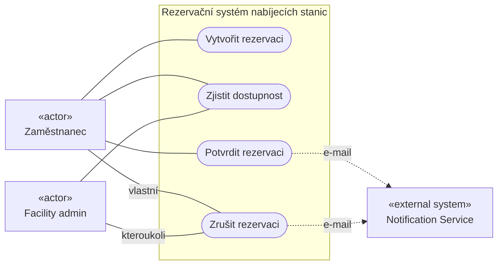
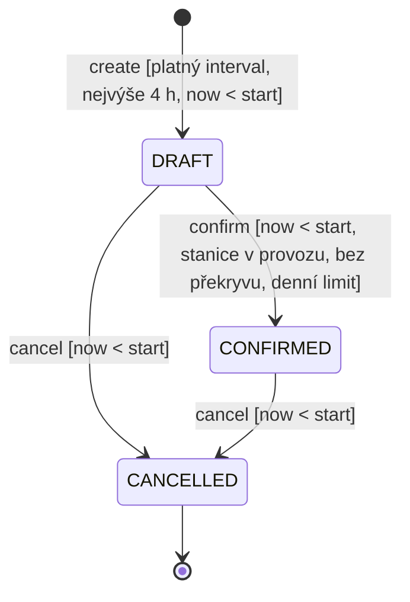
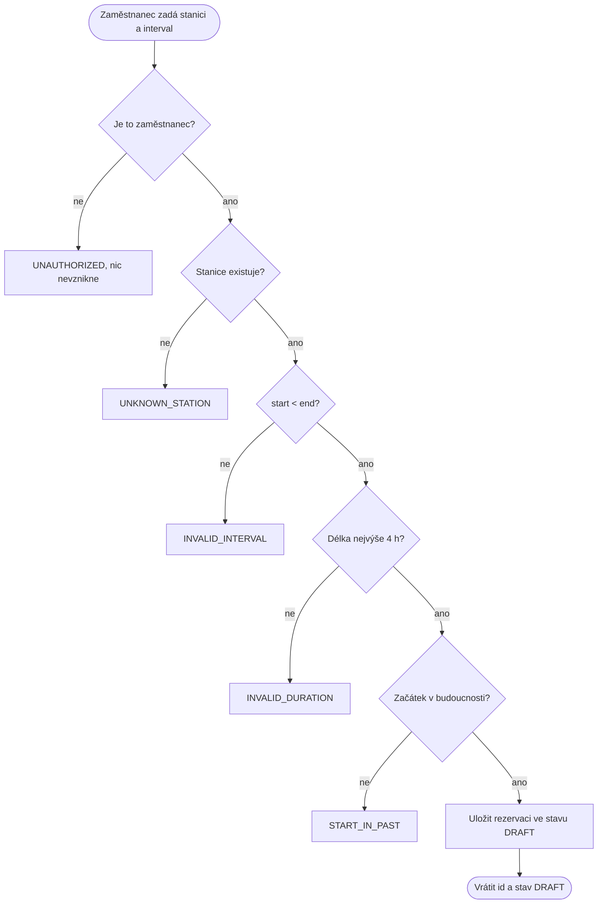
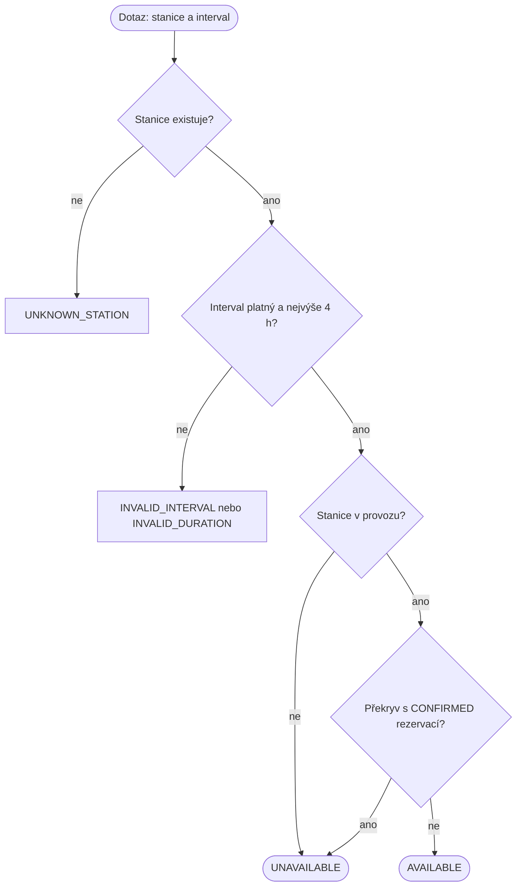
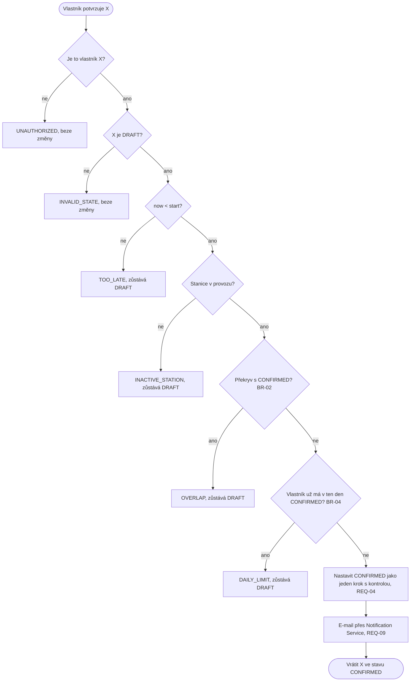
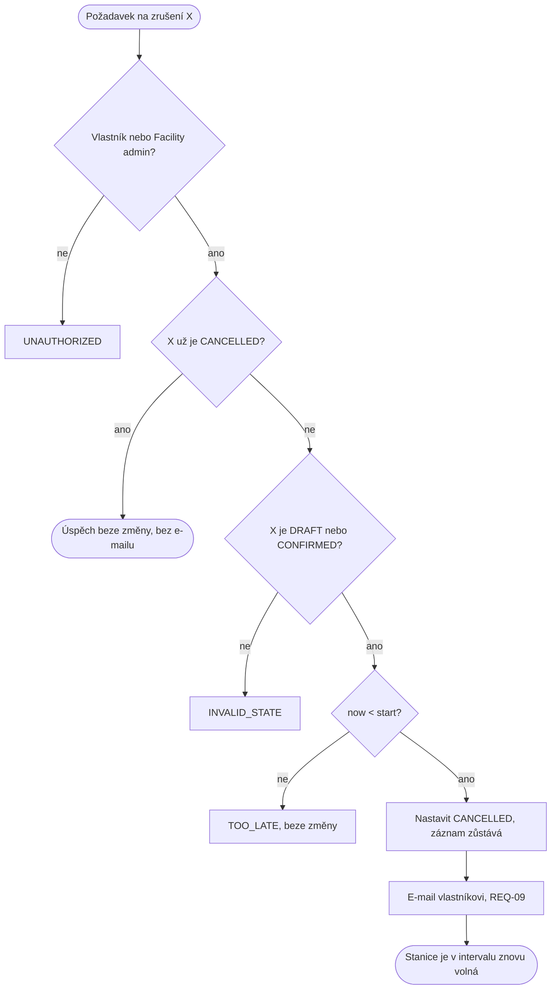
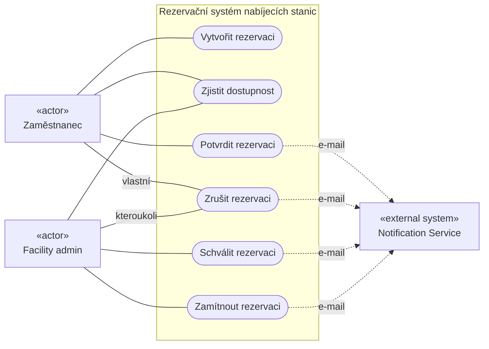
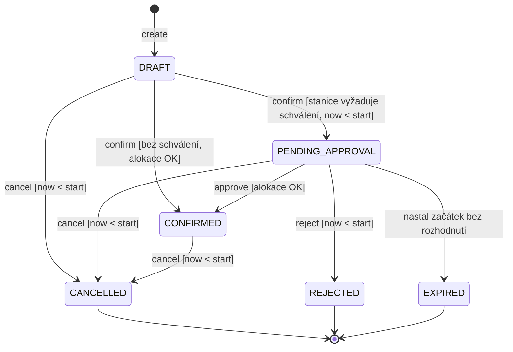
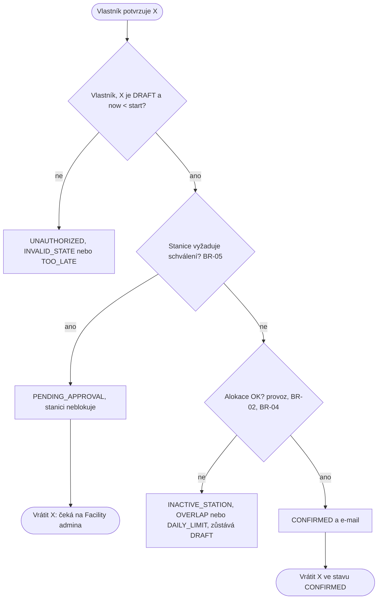
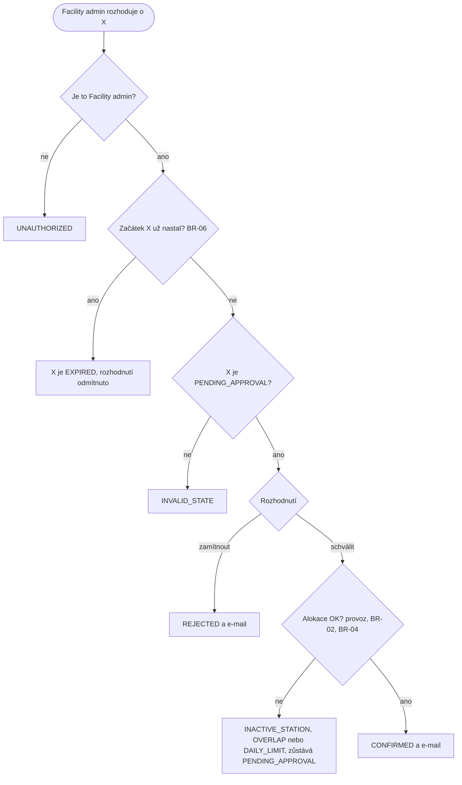

# Rezervace nabíjecích stanic pro elektromobily

Týmový projekt předmětu SWI, tým **SW-DEV-AJVZMPIA**: Viacheslav Zlobin, Maksym Panfilov, Aleksej Južaninov, Ivan Akulovich.
Repozitář: <https://github.com/alexejjuzaninov/EC-reservationSystem>

Tento README je jediný hlavní dokument projektu. Obsahuje rámec z C01, celou specifikaci C02 (baseline v0.1, změnu a baseline v0.2), diagramy, popis běžící aplikace a evidenci. Platná verze pro C03 a CP1 je **Specification Baseline v0.2**.

**▶ [Otevřít webovou ukázku](https://alexejjuzaninov.github.io/EC-reservationSystem/app/)** — běží přímo v prohlížeči, nic se neinstaluje.

[](https://alexejjuzaninov.github.io/EC-reservationSystem/app/)

## Obsah

- [Rychlý start](#rychlý-start)
- [Jak používat webovou ukázku](#jak-používat-webovou-ukázku)
  - [Nejrychlejší cesta: připravené ukázky](#nejrychlejší-cesta-připravené-ukázky)
  - [Vlastní postup krok za krokem](#vlastní-postup-krok-za-krokem)
  - [Ovládání](#ovládání)
  - [Barvy v rozvrhu](#barvy-v-rozvrhu)
  - [Pravidla, která aplikace hlídá](#pravidla-která-aplikace-hlídá)
- [Co je v repozitáři](#co-je-v-repozitáři)
- [Co systém dělá](#co-systém-dělá)
- [C01: rámec projektu](#c01-rámec-projektu)
  - [Základní informace](#základní-informace)
  - [Project Frame](#project-frame)
  - [Selected future pressure](#selected-future-pressure)
  - [Change a review](#change-a-review)
  - [Engineering spike: varianta A (persistence)](#engineering-spike-varianta-a-persistence)
  - [Evidence a rozhodnutí C01](#evidence-a-rozhodnutí-c01)
  - [Walking skeleton pro CP1](#walking-skeleton-pro-cp1)
  - [Rozhodnutí o stacku](#rozhodnutí-o-stacku)
- [C02: specifikace, společné části](#c02-specifikace-společné-části)
  - [Slovník](#slovník)
  - [Doménová pravidla a invarianty](#doménová-pravidla-a-invarianty)
  - [Přehled požadavků](#přehled-požadavků)
  - [Kontrola přijetí požadavků](#kontrola-přijetí-požadavků)
- [Baseline v0.1: čtyři základní operace](#baseline-v01-čtyři-základní-operace)
  - [OP-01 Create Reservation](#op-01-create-reservation)
  - [OP-02 Check Availability](#op-02-check-availability)
  - [OP-03 Confirm Reservation](#op-03-confirm-reservation)
  - [OP-04 Cancel Reservation](#op-04-cancel-reservation)
  - [REQ-09 Notifikace](#req-09-notifikace)
- [Diagramy v0.1](#diagramy-v01)
  - [Případy užití v0.1](#případy-užití-v01)
  - [Stavový diagram v0.1](#stavový-diagram-v01)
  - [Diagramy aktivit v0.1](#diagramy-aktivit-v01)
  - [Kontrola konzistence v0.1](#kontrola-konzistence-v01)
- [Změna C02: schvalování](#změna-c02-schvalování)
  - [Analýza dopadu](#analýza-dopadu)
  - [Dopad změny C02](#dopad-změny-c02)
- [Baseline v0.2: změněné a nové části](#baseline-v02-změněné-a-nové-části)
  - [OP-03 Confirm Reservation ve v0.2](#op-03-confirm-reservation-ve-v02)
  - [OP-04 Cancel Reservation ve v0.2](#op-04-cancel-reservation-ve-v02)
  - [OP-05 Approve / Reject Reservation](#op-05-approve--reject-reservation)
  - [REQ-09 ve v0.2](#req-09-ve-v02)
- [Diagramy v0.2](#diagramy-v02)
  - [Případy užití v0.2](#případy-užití-v02)
  - [Stavový diagram v0.2](#stavový-diagram-v02)
  - [Aktivita Confirm v0.2](#aktivita-confirm-v02)
  - [Aktivita Approve / Reject](#aktivita-approve--reject)
  - [Kontrola konzistence v0.2](#kontrola-konzistence-v02)
- [Aplikace](#aplikace)
- [Evidence C02: specifikace → běžící aplikace](#evidence-c02-specifikace--běžící-aplikace)
- [Rozhodnutí týmu a otevřené otázky](#rozhodnutí-týmu-a-otevřené-otázky)
- [Schválení a historie](#schválení-a-historie)

## Rychlý start

Aplikace C02 potřebuje jen Python 3.10 nebo novější, žádné další balíčky:

```bash
python reservation.py test    # 40 příkladů ověření ze specifikace, výsledek PASS/FAIL
python reservation.py demo    # krátká ukázka všech operací
python -m unittest discover -s tests -v    # 13 unit/component testů z Detailed Design (C05)
```

Webová ukázka: otevřete soubor `app/index.html` v prohlížeči (stačí dvojklik). Nepotřebuje server ani internet a používá stejná pravidla jako `reservation.py`. Nahoře jsou připravené ukázky, které jedním klikem projdou úspěšný i chybový případ každé operace. Návod je v části [Jak používat webovou ukázku](#jak-používat-webovou-ukázku).

Engineering spike z C01 (PostgreSQL) se spouští zvlášť:

```bash
docker run --name swi-db -e POSTGRES_PASSWORD=swi -e POSTGRES_DB=reservations -p 5432:5432 -d postgres:16
docker exec swi-db psql -U postgres -c "CREATE DATABASE reservations_test;"
cd spike
pip install -r requirements.txt
pytest -v
```

## Jak používat webovou ukázku

Ukázka je zveřejněná přes GitHub Pages: **<https://alexejjuzaninov.github.io/EC-reservationSystem/app/>**. Stačí otevřít odkaz.

Bez internetu: na GitHubu klikněte na **Code → Download ZIP**, archiv rozbalte a soubor `app/index.html` otevřete dvojklikem v prohlížeči (Chrome, Edge, Firefox). Nic se neinstaluje, data žijí jen v tomto okně: po obnovení stránky nebo tlačítkem **Začít znovu** se smažou a čas se vrátí na neděli 11. 10. 2026, 08:00 UTC.

### Nejrychlejší cesta: připravené ukázky

Nahoře v části **Připravené ukázky** klikněte na jeden ze šesti scénářů. Ukázka smaže data, sama provede několik kroků a výsledek ukáže v rozvrhu, v seznamu rezervací a v části **Co se stalo**.

| Ukázka | Co předvede |
|---|---|
| Základní průchod | vytvoření, kontrolu dostupnosti, potvrzení a zrušení jedné rezervace |
| Dva lidé, jedna stanice | návrhy se smějí překrývat, potvrzené rezervace ne; navazující čas projde |
| Limity: 4 hodiny a jednou denně | příliš dlouhá rezervace a druhá potvrzená v témže dni neprojdou |
| Schválení rychlonabíječky | rezervaci DC-1 schválí, nebo zamítne Facility admin |
| Když čas běží | po začátku rezervace ji nelze zrušit a žádost bez rozhodnutí vyprší |
| Výpadek e-mailů | Notification Service neodpovídá, potvrzení přesto platí |

### Vlastní postup krok za krokem

1. **Vyberte, za koho jednáte** (vlevo nahoře): Alice nebo Bob jsou zaměstnanci, Facility admin spravuje stanice. Všechny akce se provádějí za vybraného uživatele.
2. **Vyberte stanici, den a čas** v části **Nová rezervace**. Začátek můžete vybrat i kliknutím do volného místa v rozvrhu. Pole pod formulářem hned ukáže, zda je stanice volná a co by potvrzení odmítlo.
3. Klikněte na **Vytvořit rezervaci**. Vznikne návrh (DRAFT), stanici ještě neblokuje.
4. V seznamu **Rezervace** klikněte u návrhu na **Potvrdit**. Rezervace je CONFIRMED a stanice je v rozvrhu obsazená (zelený blok).
5. U stanice **DC-1** potvrzení jen požádá o schválení (PENDING_APPROVAL). Přepněte se na **Facility admin** a klikněte na **Schválit**, nebo **Zamítnout**.
6. Rezervaci zrušíte tlačítkem **Zrušit**. Jde to jen před jejím začátkem.

### Ovládání

| Prvek | K čemu slouží |
|---|---|
| Jednáte jako | přepíná uživatele, za kterého se provádějí akce |
| Nová rezervace | vytvoření rezervace (OP-01) a tlačítko **Ověřit dostupnost** (OP-02) |
| Rozvrh stanic | časová osa stanic AC-1, DC-1 a AC-2; šipky přepínají den, kliknutím na blok vyberete rezervaci |
| Simulovaný čas | tlačítka −1 h, +15 min, +1 h, **Na začátek vybrané** a pole **Nastavit**; červená čára v rozvrhu ukazuje „teď“ |
| Rezervace | seznam všech rezervací s akcemi podle stavu: Potvrdit, Schválit, Zamítnout, Zrušit |
| Co se stalo | historie operací: výsledek, kód chyby a pravidlo, podle kterého systém rozhodl |
| E-maily | odeslané e-maily; přepínač **Notification Service odpovídá** simuluje výpadek služby |
| Automatické ověření | dole na stránce; 40 příkladů ze specifikace, stejných jako `python reservation.py test` |

### Barvy v rozvrhu

| Vzhled bloku | Stav | Blokuje stanici? |
|---|---|---|
| šedý přerušovaný rámeček | DRAFT, návrh | ne |
| oranžové šrafování | PENDING_APPROVAL, čeká na schválení | ne |
| zelený blok | CONFIRMED, potvrzená | ano |
| přeškrtnutý nebo tečkovaný rámeček | CANCELLED, REJECTED, EXPIRED | ne |
| žlutý přerušovaný rámeček | váš výběr z formuláře | — |
| šrafovaná stopa | stanice mimo provoz (AC-2) | — |

### Pravidla, která aplikace hlídá

| Pravidlo | Co se stane při porušení |
|---|---|
| rezervaci vytváří a potvrzuje jen zaměstnanec, a to vlastní | `UNAUTHORIZED` |
| začátek musí být před koncem | `INVALID_INTERVAL` |
| rezervace trvá nejvýše 4 hodiny | `INVALID_DURATION` |
| začátek musí být v budoucnosti | `START_IN_PAST` |
| potvrzené rezervace téže stanice se nesmějí překrývat; navazující čas (konec = začátek) je v pořádku | `OVERLAP` |
| jeden uživatel má nejvýše jednu potvrzenou rezervaci za den | `DAILY_LIMIT` |
| stanici mimo provoz (AC-2) potvrdit nelze | `INACTIVE_STATION` |
| potvrdit lze jen návrh, rozhodovat jen o čekající žádosti | `INVALID_STATE` |
| po začátku rezervace ji nelze potvrdit ani zrušit | `TOO_LATE` |
| schvalovat a zamítat smí jen Facility admin | `UNAUTHORIZED` |
| o žádosti je potřeba rozhodnout do začátku rezervace | `EXPIRED` |

Odmítnutí jsou záměrná: aplikace dovolí kliknout i na akci, kterou pravidla zakazují, aby šlo předvést chybový případ. Vysvětlení se objeví v oznámení vpravo dole a v části **Co se stalo**.

## Co je v repozitáři

| Cesta | Obsah |
|---|---|
| `README.md` | tento dokument: C01 a C02 na jednom místě |
| `reservation.py` | běžící aplikace C02: doména, pravidla, příklady ověření (`test`) a ukázka (`demo`) |
| `app/index.html` | webová ukázka se stejnými pravidly a stejnými 40 příklady ověření |
| `tests/test_allocation.py` | unit a component testy odvozené z Detailed Design (C05) |
| `spike/` | engineering spike z C01: service vrstva nad PostgreSQL a testy pytest |
| `docs/intent-and-change.md` | Project Frame z C01 |
| `docs/evidence-and-evolution.md` | evidence spike C01 a evidence C02 |
| `docs/architecture-and-decisions.md` | rozhodnutí o stacku z C01, AS-IS trace z C03, Detailed Design z C05 |
| `docs/SWI-C01-reservation-system.pdf` | odevzdaný dokument C01 |
| `docs/app.png` | snímek webové ukázky |

## Co systém dělá

Firemní nabíjecí stanice pro elektromobily jsou omezený zdroj. Zaměstnanec si předem rezervuje časové okno na jedné stanici, aby po příjezdu nemusel čekat. Stanice je **exkluzivní Resource**: v jednom okamžiku ji smí mít potvrzenou nejvýše jedna rezervace.

| Aktér | Co dělá |
|---|---|
| Zaměstnanec | vytváří, potvrzuje a ruší **vlastní** rezervace |
| Facility admin | může zrušit **kteroukoli** rezervaci; od v0.2 schvaluje a zamítá rezervace stanic, které schválení vyžadují |
| Notification Service (externí systém) | pošle vlastníkovi e-mail, když se jeho rezervace potvrdí, zruší nebo zamítne |

Ukázková data v aplikaci i v testech:

| Stanice | Typ | Umístění | Vlastnost |
|---|---|---|---|
| AC-1 | AC 22 kW | Parkoviště P1, stání 1 | potvrzení platí hned |
| DC-1 | DC 50 kW | Parkoviště P1, stání 2 | od v0.2 vyžaduje schválení Facility adminem |
| AC-2 | AC 22 kW | Parkoviště P2, stání 1 | mimo provoz |

Uživatelé: `alice` a `bob` (zaměstnanci), `admin` (Facility admin). Ukázkový čas začíná v neděli 11. 10. 2026 v 08:00 UTC.

Životní cyklus rezervace v kostce: vytvořená rezervace je jen **návrh (DRAFT)** a stanici neblokuje. Stanici obsadí až **potvrzená rezervace (CONFIRMED)**. U stanice se schválením potvrzení jen požádá o schválení (**PENDING_APPROVAL**) a Facility admin ho schválí, nebo zamítne (**REJECTED**). Pokud do začátku rezervace nikdo nerozhodne, žádost vyprší (**EXPIRED**). Zrušená rezervace (**CANCELLED**) v systému zůstává.

## C01: rámec projektu

Tato část shrnuje odevzdaný dokument C01 (`docs/SWI-C01-reservation-system.pdf`) a doplňuje místa, která v něm zůstala prázdná. Rámec C01 se v C02 nemění.

### Základní informace

| Položka | Hodnota |
|---|---|
| Tým | SW-DEV-AJVZMPIA |
| Členové | Viacheslav Zlobin, Maksym Panfilov, Aleksej Južaninov, Ivan Akulovich |
| Repozitář | <https://github.com/alexejjuzaninov/EC-reservationSystem> |
| Rezervovaný Resource | nabíjecí stanice pro elektromobily (EV charging station) |
| Technologický stack | Python 3.12, FastAPI, SQLAlchemy, PostgreSQL, pytest |
| Datum C01 | 14. 09. 2026 |

### Project Frame

Plné znění je v `docs/intent-and-change.md`.

| Položka | Obsah |
|---|---|
| Reservation domain | časové sloty na firemních nabíjecích stanicích pro elektromobily |
| Purpose | zaměstnanci dojíždějící elektromobilem potřebují garantovaný slot během pracovního dne; systém předchází frontám a konfliktům na malém počtu stanic |
| Users / Stakeholders | Employee (vytváří, potvrzuje a ruší vlastní rezervace), Facility admin (spravuje stanice, může zrušit kteroukoli rezervaci) |
| Core concepts | Reservation, ChargingStation, User, TimeSlot |
| Core operations | Create (výsledek DRAFT), Confirm / approve (DRAFT → CONFIRMED), Cancel (DRAFT nebo CONFIRMED → CANCELLED), Check availability |
| Persistent state | Reservation: id, user_id, station_id, start_time, end_time, state, created_at; ChargingStation: id, connector_type, power_kw, location, active; User: id, email, vehicle_type |
| State-changing operation | `confirm(reservation_id)`: DRAFT → CONFIRMED; kontrola překryvu běží až v tuto chvíli, DRAFT je jen záměr a smí se překrývat |
| Common business rule | potvrzené rezervace téže stanice se nesmějí překrývat |
| Domain-specific rule | uživatel smí mít nejvýše jednu potvrzenou rezervaci za kalendářní den a ta smí trvat nejvýše 4 hodiny |
| External / system boundary | Notification Service: e-mail při potvrzení a zrušení, volaná přes HTTP, může být pomalá nebo nedostupná |
| Assumption | uživatelé sami ruší rezervace, které nepotřebují, takže zatím není potřeba automatické uvolňování |
| Unknown | nevíme, jak se má systém zachovat, když je Notification Service při potvrzení nedostupná (C02 to rozhodlo, viz REQ-09) |

### Selected future pressure

| Položka | Obsah |
|---|---|
| Kategorie | R: Risk / Higher consequence |
| Pressure | systém se rozšíří z interního parkoviště na veřejné stanice s placenou rezervací; dvojitá rezervace pak znamená, že platící zákazník přijede k obsazené stanici |
| Proč je relevantní | dnes stojí překryv pět minut čekání, s platbou znamená vracení peněz, stížnosti a ztrátu důvěry; pravidlo o překryvu proto musí být vynucené na jednom místě v service vrstvě a pokryté automatickým testem, ne kontrolou v UI |

### Change a review

| Krok | Provedení |
|---|---|
| Issue | #1 C01 engineering spike: enforce non-overlapping confirmed reservations |
| Autor změny | [DOPLNIT jméno], větev `spike/overlap-check` |
| Reviewer | [DOPLNIT jméno], Pull Request #2, review před mergem |
| Obsah review | kontrola překryvu je v service vrstvě, ne v endpointu; hraniční případ konec == začátek je povolený; test bez opravy skutečně padá |
| Integrace | PR #2 sloučen do `main` po schválení reviewerem |

### Engineering spike: varianta A (persistence)

Rezervace se ukládá do skutečné databáze PostgreSQL, znovu se načte a ověří se vynucení pravidla o překryvu. Kód je ve složce `spike/` (příkazy viz [Rychlý start](#rychlý-start)).

Testovaný scénář (`spike/tests/test_overlap.py`):

1. Do databáze se zapíše stanice a dva uživatelé.
2. Rezervace A 09:00–11:00, potvrzení: očekáváno CONFIRMED.
3. Rezervace B 10:00–12:00 na téže stanici, potvrzení: očekávána výjimka `OverlapError`.
4. Rezervace C 11:00–13:00 navazuje na A, potvrzení: očekáváno CONFIRMED.
5. Nové načtení v jiné session ověří, že stavy v databázi opravdu přetrvaly.

Druhý test (`spike/tests/test_concurrency_risk.py`) odpovídá na otázku spike přímo: pustí dvě potvrzení překrývajících se rezervací ve dvou vláknech a bariérou zajistí, že oba požadavky dokončí kontrolu překryvu dřív, než kterýkoli zapíše.

Pozorovaný výsledek (PostgreSQL 16, `pytest -v` ve složce `spike/`):

```text
tests/test_concurrency_risk.py::test_two_concurrent_confirmations_cannot_both_succeed XFAIL [ 50%]
tests/test_overlap.py::test_overlapping_confirmation_is_rejected_and_state_persists PASSED [100%]
========================= 1 passed, 1 xfailed in 0.15s =========================
```

Sekvenčně kontrola v service vrstvě překryv zachytí a navazující rezervace projde. Při souběhu ale **obě** rezervace skončí CONFIRMED (`AssertionError: assert 2 == 1`), protože databáze sama žádné omezení nemá. Test `test_overlap.py` bez kontroly překryvu padá, takže kontrolu opravdu ověřuje.

### Evidence a rozhodnutí C01

| Položka | Obsah |
|---|---|
| Question / unknown | Dokáže datová vrstva spolehlivě vynutit pravidlo o nepřekrývajících se CONFIRMED rezervacích, nebo se dvě souběžná potvrzení mohou prosadit obě? |
| What we did | PostgreSQL v Dockeru, entity a service vrstva, test se dvěma překrývajícími se a jednou navazující rezervací a test souběhu se dvěma vlákny; spuštěno přes pytest |
| Observed result | sekvenčně: překryv odmítnut, navazující rezervace potvrzena, stav po novém načtení trvá (1 passed); souběžně: obě potvrzení projdou (`assert 2 == 1`, test označen xfail) |
| Decision / what changes | kontrolu v service vrstvě necháváme jako čitelnou validaci; aby pravidlo platilo i při souběhu, dostane CP1 záruku na úrovni databáze (EXCLUDE constraint nad `tstzrange`, nebo zámek stanice v transakci); návrh v C03; souvisí s pressure R |

### Walking skeleton pro CP1

Definice z C01. Spustitelný musí být až po C03, před C04:

```text
POST /reservations
  → validate      (Pydantic schema + business rules)
  → persist       (SQLAlchemy → PostgreSQL)
  → return reservation ID
  → automated check (pytest: POST vrátí 201 a ID, záznam je v DB)
```

Cesta je záměrně tenká: jeden endpoint, jedna tabulka, jeden automatický test. Aplikace C02 (`reservation.py`) je zatím záměrně jednoduchá a běží jen v paměti; v C03 se její chování přenese do této kostry.

### Rozhodnutí o stacku

Python 3.12 + FastAPI + SQLAlchemy + PostgreSQL + pytest místo výchozího Java / Spring Boot. Tým má s Pythonem zkušenosti, se Springem nikdo. Cena: stack si podporujeme sami, bez referenčního nastavení vyučujícího. FastAPI dává validaci (Pydantic) a OpenAPI, PostgreSQL zůstává z doporučeného stacku. Plné znění je v `docs/architecture-and-decisions.md`.

## C02: specifikace, společné části

Specifikace navazuje na Project Frame z C01 a nemění jeho doménu: Resource je nabíjecí stanice, uživatel je zaměstnanec, schvaluje Facility admin. Pojmy, pravidla a přehled požadavků jsou definované jen jednou zde; operace na ně odkazují.

Formulace požadavků (REQ) a pravidel (BR) jsou anglicky stejně jako referenční příklady v zadání, vysvětlení česky.

### Slovník

| Pojem | Význam |
|---|---|
| Stanice (ChargingStation) | exkluzivní Resource; v jednom okamžiku ji smí mít potvrzenou nejvýše jedna rezervace |
| Interval | `[start, end)` v UTC, `start < end` (BR-01) |
| Překryv | `A.start < B.end ∧ B.start < A.end` |
| Alokace | stanici blokuje pouze rezervace ve stavu CONFIRMED |
| Zaměstnanec (EMPLOYEE) | vytváří, potvrzuje a ruší vlastní rezervace |
| Facility admin (ADMIN) | může zrušit kteroukoli rezervaci; od v0.2 schvaluje a zamítá; správa stanic z C01 není součástí minimálního systému C02 (stanice jsou připravená data) |
| now | systémové hodiny v UTC; v testech a ve webové ukázce simulované |
| Kalendářní den | datum začátku rezervace v UTC (BR-04) |
| DRAFT | záměr uživatele; stanici neblokuje a smí se překrývat |
| CONFIRMED | platná alokace stanice |
| CANCELLED | stažená rezervace; záznam se nemaže |
| PENDING_APPROVAL (v0.2) | žádost čeká na rozhodnutí Facility admina; stanici neblokuje |
| REJECTED (v0.2) | Facility admin žádost zamítl; konečný stav |
| EXPIRED (v0.2) | do začátku rezervace o ní nikdo nerozhodl; konečný stav |

### Doménová pravidla a invarianty

**BR-01 Interval semantics.** Reservation intervals are half-open `[start, end)` in UTC with `start < end`. Two intervals overlap iff `A.start < B.end` and `B.start < A.end`; `[09:00, 11:00)` and `[11:00, 13:00)` do not overlap.

**BR-02 Exclusive station invariant** (společné pravidlo z C01). In no committed system state may two CONFIRMED Reservations of the same charging station overlap. No other state counts towards this invariant.

**BR-03 Cancellation policy** (rozhodnutí týmu).
- An employee may cancel their own Reservation, a Facility admin any Reservation (C01).
- A Reservation can be cancelled in DRAFT or CONFIRMED (v0.2: also PENDING_APPROVAL), only while `now < start_time`. This applies to the Facility admin too.
- Cancelling an already CANCELLED Reservation is an idempotent success: nothing changes and no e-mail is sent.
- REJECTED and EXPIRED Reservations cannot be cancelled.
- Records are never deleted.
- Operations on Reservations are serialized: the later operation sees the result of the earlier one. Confirm then Cancel gives CANCELLED; Cancel then Confirm gives `INVALID_STATE` and the Reservation stays CANCELLED.

**BR-04 Duration and daily limit** (doménové pravidlo z C01).
- A Reservation must not be longer than 4 hours.
- A user may hold at most one CONFIRMED Reservation per calendar day; the calendar day is the UTC date of `start_time`.
- The duration is checked when a slot is requested (Create, Check Availability); the daily limit when a Reservation would become CONFIRMED (Confirm, v0.2 also Approve).

**BR-05 Approval requirement** (v0.2). If a station has `requires_approval = false`, Confirm allocates it immediately. If `requires_approval = true`, Confirm only requests approval (DRAFT → PENDING_APPROVAL) and the allocation happens on Approve. In the demo data this is DC-1.

**BR-06 Approval deadline** (v0.2). The deadline for a decision is `start_time`. A PENDING_APPROVAL Reservation becomes EXPIRED when `now ≥ start_time`. The expiry is evaluated at the beginning of every operation (lazily); there is no timer and no invented timeout.

### Přehled požadavků

| REQ | Operace | Stručně | Verze |
|---|---|---|---|
| REQ-01 | OP-01 Create | vznikne DRAFT, stanice se neblokuje | v0.1 |
| REQ-02 | OP-02 Check Availability | UNAVAILABLE jen při překryvu s CONFIRMED nebo u stanice mimo provoz | v0.1 |
| REQ-03 | OP-03 Confirm | DRAFT → CONFIRMED jen bez konfliktu podle BR-02 a BR-04 | v0.1 |
| REQ-03b | OP-03 Confirm | u stanice se schválením jen DRAFT → PENDING_APPROVAL | v0.2 |
| REQ-04 | OP-03, OP-05 | ze souběžných konfliktních potvrzení nejvýše jedno CONFIRMED | v0.1, od v0.2 i pro Approve |
| REQ-05 | OP-04 Cancel | zrušení podle BR-03 | v0.1, ve v0.2 i PENDING_APPROVAL |
| REQ-06 | OP-05 Approve | PENDING_APPROVAL → CONFIRMED jen bez konfliktu | v0.2 |
| REQ-07 | OP-05 Reject | PENDING_APPROVAL → REJECTED | v0.2 |
| REQ-08 | OP-05, BR-06 | žádost po začátku rezervace vyprší | v0.2 |
| REQ-09 | OP-03, OP-04, OP-05 | e-mail vlastníkovi; výpadek služby nemění výsledek | v0.1, ve v0.2 i REJECTED |

### Kontrola přijetí požadavků

Každý požadavek prošel otázkami z bodu 3 zadání. Význam pojmů určuje slovník. Všechny požadavky popisují pozorovatelný výsledek: stav rezervace, odpověď systému nebo e-mail. Žádný nepředepisuje technologii; PostgreSQL, zámek nebo HTTP jsou rozhodnutí návrhu. Proveditelnost a konzistenci ověřuje kontrola konzistence u každé verze a 40 automatických příkladů. Zbylé otázky shrnuje tabulka.

| REQ | Proč je potřeba | Co ukáže splnění a co porušení | Stav, čas, hranice | Souběh | Nejistota |
|---|---|---|---|---|---|
| REQ-01 | záznam záměru bez blokace stanice (C01) | splnění: vznikne jeden DRAFT; porušení: vznikne rezervace s neplatným intervalem, delší než 4 h nebo do minulosti | přesně 4 h je povoleno; `start == now` je odmítnuto | Create nic neblokuje, souběh nevadí | žádná |
| REQ-02 | uživatel předem ví, zda potvrzení projde | porušení: navazující interval hlášen jako obsazený, DRAFT nebo PENDING blokuje, stanice mimo provoz hlášena jako volná | polootevřený interval, blokuje jen CONFIRMED | jen čtení; výsledek je okamžitý snímek | žádná |
| REQ-03 | jediný okamžik, kdy vzniká alokace | porušení: CONFIRMED přes překryv, druhá CONFIRMED v témže dni, CONFIRMED po začátku | jen z DRAFT, `now < start` | viz REQ-04 | žádná |
| REQ-03b | schválení vybraných stanic (změna C02) | porušení: rezervace DC-1 je po Confirm rovnou CONFIRMED nebo už blokuje stanici | jen z DRAFT, `now < start` | žádost nic neblokuje | žádná |
| REQ-04 | dvojí rezervace je přesně riziko pressure R | porušení: dvě překrývající se CONFIRMED téže stanice nebo dvě CONFIRMED jednoho uživatele v témže dni | rozhoduje okamžik zápisu | ano, je to business výsledek | jak to zajistit ve více procesech: C03, driver D1 |
| REQ-05 | uvolnit stanici (Assumption C01) | porušení: zrušení po začátku, zrušení cizí rezervace zaměstnancem, druhý e-mail při opakovaném zrušení | `now < start`; již CANCELLED je úspěch | serializace s Confirm (BR-03) | žádná |
| REQ-06 | alokace až po rozhodnutí oprávněné osoby | porušení: schválení přes překryv nebo denní limit, schválení zaměstnancem | `now < start` | sdílí BR-02 a BR-04 s Confirm (REQ-04) | žádná |
| REQ-07 | oprávněná osoba může žádost odmítnout | porušení: zamítnutá rezervace blokuje nebo jde schválit | jen z PENDING_APPROVAL | jako REQ-06 | žádná |
| REQ-08 | žádost nesmí viset po začátku rezervace | porušení: schválení v čase začátku nebo později projde | hranice `now == start` už je EXPIRED | žádný | e-mail při vypršení: TBD-02 |
| REQ-09 | uživatel se dozví výsledek; hranice z C01 | porušení: výpadek služby změní nebo vrátí potvrzení | po změně stavu | žádný | opakované doručení: TBD-02 |

## Baseline v0.1: čtyři základní operace

Stav: **Specification Baseline v0.1, schválená týmem** [DOPLNIT jména a datum schválení]. Popis operací odpovídá stavu před změnou C02; co se ve v0.2 změnilo, je v části [Baseline v0.2](#baseline-v02-změněné-a-nové-části).

### OP-01 Create Reservation

**Cíl / hodnota pro uživatele:** zaměstnanec si zaznamená záměr nabíjet na stanici v určitém čase. Stanice se tím ještě neblokuje.

**Spouštěcí událost:** identifikovaný zaměstnanec požádá o rezervaci stanice S v intervalu I.

**Pozorovatelný požadavek:**
**REQ-01:** The system shall create a DRAFT Reservation owned by the requesting employee for an existing station when the interval is valid under BR-01, is at most 4 hours long (BR-04) and starts after the current time.

**Předpoklady:**
- uživatel existuje a má roli EMPLOYEE;
- stanice existuje (smí být i mimo provoz, DRAFT je jen záměr);
- `start < end`, délka nejvýše 4 h, `now < start`.

**Stav po úspěšném provedení:** existuje právě jedna nová rezervace ve stavu DRAFT, jejím vlastníkem je žadatel a stanice zůstává volná.

**Změna stavu:** `[none] → DRAFT`

**Odkaz na pravidla:** BR-01, BR-04 (délka).

**Hlavní úspěšný scénář:**
1. Zaměstnanec zadá stanici a interval.
2. Systém ověří roli, existenci stanice, interval, délku a to, že začátek je v budoucnosti.
3. Systém uloží rezervaci ve stavu DRAFT.
4. Systém vrátí identifikátor a stav.

**Alternativní / chybové výsledky** (rezervace nikdy nevznikne):
- neznámý uživatel nebo Facility admin → `UNAUTHORIZED`;
- neznámá stanice → `UNKNOWN_STATION`;
- `start ≥ end` → `INVALID_INTERVAL`;
- délka nad 4 h → `INVALID_DURATION`;
- `start ≤ now` → `START_IN_PAST`.

**Příklady ověření** (now = 2026-10-11 08:00):

| Situace | Výsledek |
|---|---|
| alice, AC-1, `[10:00, 11:00)` | jeden DRAFT, vlastník alice |
| alice a bob, oba AC-1 `[10:00, 11:00)` | dva DRAFTy, překryv návrhů nevadí |
| `[10:00, 10:00)` | `INVALID_INTERVAL` |
| `[09:00, 13:00)`, přesně 4 h | DRAFT |
| `[09:00, 13:30)`, 4,5 h | `INVALID_DURATION` |
| `[07:00, 08:00)` | `START_IN_PAST` |
| neznámá stanice XX-9 | `UNKNOWN_STATION` |
| vytváří Facility admin | `UNAUTHORIZED` |

**Zdůvodnění:** C01 rozhodl, že překryv se kontroluje až při potvrzení: DRAFT je jen záměr a smí se překrývat. Délku, která nezávisí na ostatních rezervacích, kontrolujeme hned, protože příliš dlouhou rezervaci by nešlo nikdy potvrdit. Rezervace do minulosti nedává smysl, nabíjet se v ní už nedá.

**Předpoklad / neznámá / TBD:** žádné.

### OP-02 Check Availability

**Cíl / hodnota pro uživatele:** zaměstnanec předem zjistí, zda by šlo stanici v daném čase potvrdit.

**Spouštěcí událost:** uživatel se zeptá na stanici S a interval I.

**Pozorovatelný požadavek:**
**REQ-02:** For a valid interval, the system shall report a station as UNAVAILABLE if the station is out of service or the interval overlaps a CONFIRMED Reservation of that station; otherwise it shall report it as AVAILABLE.

**Předpoklady:** stanice existuje; interval je platný (BR-01) a nejvýše 4 h dlouhý (BR-04).

**Stav po úspěšném provedení:** systém vrátí AVAILABLE nebo UNAVAILABLE. Operace sama žádnou rezervaci nemění; vyhodnocení vypršení podle BR-06 je společné všem operacím.

**Změna stavu:** žádná.

**Odkaz na pravidla:** BR-01, BR-02, BR-04.

**Hlavní úspěšný scénář:**
1. Uživatel zadá stanici a interval.
2. Systém ověří stanici a interval.
3. Systém zjistí, zda je stanice v provozu a zda se interval překrývá s potvrzenou rezervací této stanice.
4. Systém vrátí AVAILABLE nebo UNAVAILABLE.

**Alternativní / chybové výsledky:** neznámá stanice → `UNKNOWN_STATION`; neplatný interval → `INVALID_INTERVAL`; delší než 4 h → `INVALID_DURATION`.

**Příklady ověření** (existuje CONFIRMED `[10:00, 11:00)` na AC-1):

| Dotaz | Výsledek |
|---|---|
| AC-1 `[09:00, 10:00)` | AVAILABLE (hranice, polootevřený interval) |
| AC-1 `[10:30, 11:30)` | UNAVAILABLE |
| AC-1 `[11:00, 12:00)` | AVAILABLE |
| AC-1 `[14:00, 15:00)`, kde je jen DRAFT | AVAILABLE |
| AC-2 (mimo provoz), jakýkoli interval | UNAVAILABLE |

**Zdůvodnění:** odpověď musí odpovídat tomu, jak rozhodne potvrzení: stejný význam překryvu (BR-01), stejné blokující stavy (jen CONFIRMED) a stanici mimo provoz potvrdit nejde, proto je UNAVAILABLE.

**Předpoklad / neznámá / TBD:** výsledek je okamžitý snímek. AVAILABLE nic nerezervuje a pozdější potvrzení může skončit `OVERLAP`.

### OP-03 Confirm Reservation

**Cíl / hodnota pro uživatele:** platný návrh se stane platnou alokací stanice.

**Spouštěcí událost:** vlastník rezervace X požádá o její potvrzení.

**Pozorovatelné požadavky:**
**REQ-03:** The system shall confirm a DRAFT Reservation only when it has not started yet, its station is active, its interval does not overlap a CONFIRMED Reservation of the same station (BR-02) and its owner has no other CONFIRMED Reservation on the same calendar day (BR-04); otherwise the Reservation shall remain DRAFT.

**REQ-04:** For concurrent confirmation attempts that conflict under BR-02 or BR-04, at most one Reservation shall reach CONFIRMED.

**Předpoklady:** X existuje; `X.state = DRAFT`; žadatel je vlastník X.

**Stav po úspěšném provedení:** `X.state = CONFIRMED`, X blokuje stanici, BR-02 i BR-04 platí a vlastníkovi odešel e-mail (REQ-09).

**Změna stavu:** `DRAFT → CONFIRMED`

**Odkaz na pravidla:** BR-01, BR-02, BR-04.

**Hlavní úspěšný scénář:**
1. Vlastník požádá o potvrzení X.
2. Systém ověří vlastnictví a stav DRAFT.
3. Systém ověří, že rezervace ještě nezačala a stanice je v provozu.
4. Systém ověří, že se X nepřekrývá s potvrzenou rezervací stanice (BR-02).
5. Systém ověří, že vlastník nemá v ten den jinou potvrzenou rezervaci (BR-04).
6. Systém nastaví CONFIRMED; kontrola a zápis proběhnou jako jeden krok vůči ostatním potvrzením (REQ-04).
7. Systém pošle e-mail přes Notification Service.
8. Systém vrátí X ve stavu CONFIRMED.

**Alternativní / chybové výsledky** (X se nemění):
- cizí rezervace nebo Facility admin → `UNAUTHORIZED`;
- X není DRAFT → `INVALID_STATE`;
- `now ≥ start` → `TOO_LATE`;
- stanice mimo provoz → `INACTIVE_STATION`;
- překryv s potvrzenou rezervací → `OVERLAP` s id konfliktní rezervace;
- vlastník už má v ten den potvrzenou rezervaci → `DAILY_LIMIT` s id té rezervace.

**Příklady ověření:**

| Situace | Výsledek |
|---|---|
| volný DRAFT na AC-1 | CONFIRMED a e-mail alice@example.com |
| CONFIRMED bob `[10:00, 11:00)`, alice potvrzuje `[10:30, 11:30)` | `OVERLAP` (R0001), zůstává DRAFT |
| CONFIRMED `[09:00, 11:00)`, potvrzení `[11:00, 13:00)` | CONFIRMED |
| alice má CONFIRMED 09:00–10:00, potvrzuje 15:00–16:00 téhož dne | `DAILY_LIMIT`, zůstává DRAFT |
| totéž o den později | CONFIRMED |
| DRAFT na AC-2 (mimo provoz) | `INACTIVE_STATION`, zůstává DRAFT |
| bob potvrzuje rezervaci alice | `UNAUTHORIZED` |
| potvrzení už potvrzené rezervace | `INVALID_STATE` |
| now = 09:00, rezervace `[09:00, 10:00)` | `TOO_LATE` |
| dvě souběžná potvrzení stejného intervalu | právě jedno CONFIRMED, druhé `OVERLAP` |

**Zdůvodnění:** C01 určil, že překryv se kontroluje v okamžiku potvrzení. Souběh (REQ-04) není implementační detail, rozhoduje o tom, zda vznikne dvojí rezervace, což je přesně riziko vybrané pressure R.

**Předpoklad / neznámá / TBD:** jak REQ-04 zajistit, když poběží víc procesů aplikace: C03, driver D1.

### OP-04 Cancel Reservation

**Cíl / hodnota pro uživatele:** rezervaci, kterou už nepotřebuje, uživatel stáhne a stanice se uvolní.

**Spouštěcí událost:** vlastník nebo Facility admin požádá o zrušení rezervace X.

**Pozorovatelný požadavek:**
**REQ-05:** The system shall cancel a DRAFT or CONFIRMED Reservation when the caller is its owner or a Facility admin and `now < start_time`; cancelling an already CANCELLED Reservation is an idempotent success (BR-03).

**Předpoklady:** X existuje; `X.state ∈ {DRAFT, CONFIRMED}`; `now < start_time`.

**Stav po úspěšném provedení:** `X.state = CANCELLED`, X stanici neblokuje, záznam zůstává a vlastníkovi odešel e-mail (REQ-09).

**Změna stavu:** `DRAFT | CONFIRMED → CANCELLED`

**Odkaz na pravidla:** BR-03.

**Hlavní úspěšný scénář:**
1. Vlastník nebo Facility admin požádá o zrušení X.
2. Systém ověří oprávnění.
3. Je-li X už zrušená, vrátí ji beze změny.
4. Systém ověří stav a to, že rezervace ještě nezačala.
5. Systém nastaví CANCELLED, záznam zůstává.
6. Systém pošle e-mail vlastníkovi.
7. Následná kontrola dostupnosti hlásí interval jako AVAILABLE, pokud ho neblokuje jiná potvrzená rezervace.

**Alternativní / chybové výsledky:**
- zaměstnanec ruší cizí rezervaci → `UNAUTHORIZED`;
- `now ≥ start_time` → `TOO_LATE`, stav se nemění;
- již zrušená → úspěch beze změny, bez e-mailu;
- jiný stav (od v0.2 REJECTED, EXPIRED) → `INVALID_STATE`.

**Příklady ověření:**

| Situace | Výsledek |
|---|---|
| DRAFT před začátkem | CANCELLED |
| CONFIRMED `[10:00, 11:00)` před začátkem | CANCELLED, interval AVAILABLE, e-mail |
| CONFIRMED `[09:00, 10:00)`, now = 09:00 | `TOO_LATE`, zůstává CONFIRMED |
| druhé zrušení téže rezervace | úspěch, stav CANCELLED, žádný další e-mail |
| bob ruší rezervaci alice | `UNAUTHORIZED` |
| Facility admin ruší rezervaci alice | CANCELLED |

**Zdůvodnění:** podle Assumption z C01 uživatelé sami ruší rezervace, které nepotřebují, takže zrušení musí být jednoduché a stanici hned uvolnit. Hranice „před začátkem“ je `now < start_time` a zdrojem času jsou systémové hodiny v UTC.

**Předpoklad / neznámá / TBD:** žádné.

### REQ-09 Notifikace

Společný požadavek pro OP-03 a OP-04 (od v0.2 i OP-05), vychází z hranice systému v C01.

**REQ-09:** When a Reservation becomes CONFIRMED or CANCELLED, the system shall send an e-mail to its owner through the Notification Service; if the service is unavailable, the state change shall still hold and the failed e-mail shall be recorded.

Tím je rozhodnuta neznámá z C01: když Notification Service nefunguje, potvrzení platí a e-mail se zapíše jako nedoručený. Opakované doručení zůstává otevřené (TBD-02).

| Situace | Výsledek |
|---|---|
| Notification Service nedostupná, potvrzení volné rezervace | CONFIRMED, e-mail se stavem FAILED |

## Diagramy v0.1

### Případy užití v0.1



Hranice systému obsahuje čtyři cíle. Notification Service je skutečný podpůrný systém z hranice C01, ne vymyšlený aktér.

### Stavový diagram v0.1



### Diagramy aktivit v0.1

**OP-01 Create Reservation**



**OP-02 Check Availability**



**OP-03 Confirm Reservation**



**OP-04 Cancel Reservation**



### Kontrola konzistence v0.1

| Kontrola | Výsledek |
|---|---|
| Create vs Confirm | Create nealokuje a nekontroluje překryv ani denní limit; alokace vzniká jen potvrzením |
| Availability vs Confirm | obě operace považují za blokující jen CONFIRMED a stanici mimo provoz obě odmítají |
| Cancel vs stavový diagram | text dovoluje zrušit DRAFT i CONFIRMED před začátkem; diagram má přesně tyto dva přechody |
| Význam intervalů | všude `[start, end)`; příklady s hranicí 10:00 a 11:00 jsou v textu, v testech i ve webové ukázce |
| Případy užití vs text | každý cíl má operaci a každá operace cíl; zrušení kterékoli rezervace Facility adminem je v textu (BR-03), v diagramu i v kódu |
| Požadavek vs návrh | žádný požadavek nepředepisuje PostgreSQL, zámek ani HTTP |
| Nejistota vs přesnost | 4 h a kalendářní den jsou z C01; časové pásmo dne je vědomé rozhodnutí DEC-04; žádný vymyšlený timeout ani počet opakování |

## Změna C02: schvalování

**Změnová karta:** některé stanice vyžadují schválení oprávněnou osobou dřív, než se rezervace může stát CONFIRMED. Schválení může přijít se zpožděním, být zamítnuto nebo vypršet.

### Analýza dopadu

Provedena dřív, než se upravila specifikace.

| Oblast | Otázka | Rozhodnutí týmu |
|---|---|---|
| Create | Mění se Create? | Nemění. Stále vzniká jen DRAFT bez alokace a bez kontroly překryvu. |
| Availability | Blokuje PENDING_APPROVAL stanici? | Neblokuje. Schválení může přijít pozdě nebo být zamítnuto; držet stanici by vytvořilo skryté předběžné blokování, které v0.1 nemá. Alokace zůstává jen CONFIRMED (BR-02). |
| Confirm | Je Confirm stále okamžitý? | Rozdělí se podle stanice. Bez schválení zůstává okamžitou alokací. Se schválením je Confirm jen žádost (DRAFT → PENDING_APPROVAL) a alokace vzniká až schválením. |
| Approve | Vzniká nová operace? Kdo ji smí provést? | Ano, OP-05 Approve / Reject. Provádí ji Facility admin, který už v C01 existuje. Nový aktér nevzniká. |
| Cancel | Lze zrušit PENDING_APPROVAL? | Ano, za stejných podmínek jako DRAFT (BR-03). |
| Stavový diagram | Jaké nové stavy? | PENDING_APPROVAL, REJECTED, EXPIRED. REJECTED a EXPIRED jsou oddělené od CANCELLED, aby bylo vidět, proč rezervace skončila. |
| Případy užití | Nový aktér nebo cíl? | Nové cíle Facility admina: Schválit a Zamítnout rezervaci. |
| Ověření | Jak ověříte zpoždění, zamítnutí a vypršení? | Řízené hodiny v testech: schválení v 09:59 při začátku 10:00 projde, v 10:00 už je EXPIRED; zamítnutí ponechá stanici volnou; dostupnost se ověřuje i během čekání. |
| Architektura | Vzniká nový driver? | Ano: perzistentní čekání na člověka, vypršení podle času, souběh Approve a Confirm nad stejným pravidlem, notifikace. Viz D1 až D4. |

### Dopad změny C02

**Změněná podmínka:** rezervace stanice s `requires_approval` smí být CONFIRMED jen po rozhodnutí Facility admina; rozhodnutí může přijít později, být zamítavé nebo nestihnout začátek rezervace.

**Dotčené požadavky a části specifikace:** OP-03 Confirm (nový REQ-03b), OP-04 Cancel (REQ-05 nově i pro PENDING_APPROVAL), REQ-04 (platí i pro Approve), REQ-09 (e-mail i při zamítnutí), nová pravidla BR-05 a BR-06, nová operace OP-05 s REQ-06 až REQ-08, slovník (nové stavy), případy užití, stavový diagram, aktivita Confirm a nová aktivita Approve / Reject.

**Nedotčené části a proč:**
- OP-01 Create a REQ-01: stále vzniká jen DRAFT;
- OP-02 a REQ-02: blokuje stále jen CONFIRMED a PENDING_APPROVAL úmyslně neblokuje;
- BR-01, BR-02, BR-04: význam intervalu, invariant stanice ani denní limit se nemění;
- časová hranice zrušení `now < start_time`;
- stanice bez schválení (AC-1) se chovají přesně jako ve v0.1, všechny příklady v0.1 procházejí beze změny.

**Nový aktér / operace:** nový aktér nevzniká; Facility admin dostává operaci OP-05 Approve / Reject Reservation.

**Změněná pravidla a význam stavů:** CONFIRMED zůstává jedinou alokací; PENDING_APPROVAL je čekající žádost; EXPIRED je žádost, o které nikdo nerozhodl do začátku; BR-03 nově dovoluje zrušit i PENDING_APPROVAL.

**Změna diagramu případů užití:** přibyly cíle Schválit rezervaci a Zamítnout rezervaci pro Facility admina.

**Změna stavového diagramu:** stavy PENDING_APPROVAL, REJECTED, EXPIRED a přechody DRAFT → PENDING_APPROVAL → CONFIRMED / REJECTED / EXPIRED / CANCELLED.

**Nové příklady ověření:** u REQ-03b a OP-05 níže.

**Architektonické drivery pro C03:**
1. **D1 Jedno autoritativní místo pro zápis CONFIRMED.** Confirm i Approve sdílejí BR-02 a BR-04. Dnes je chrání jeden zámek v jednom procesu; při více procesech nebo instancích nestačí.
2. **D2 Perzistence čekající žádosti.** PENDING_APPROVAL musí přežít konec požadavku i restart aplikace, protože Facility admin rozhoduje později.
3. **D3 Vypršení podle času.** Přechod do EXPIRED dnes nastane, až se systému někdo zeptá. Pro e-mail o vypršení nebo přehled žádostí bude potřeba plánovač.
4. **D4 Notifikace nesmí určovat business výsledek.** Výpadek Notification Service nesmí změnit ani vrátit potvrzení, schválení či zamítnutí.

## Baseline v0.2: změněné a nové části

Stav: **Specification Baseline v0.2, schválená týmem** [DOPLNIT jména a datum schválení]. Vše, co zde není uvedeno, platí beze změny z v0.1.

### OP-03 Confirm Reservation ve v0.2

**REQ-03b:** If the station does not require approval, Confirm behaves as REQ-03. If the station requires approval, Confirm of a DRAFT Reservation that has not started yet shall set PENDING_APPROVAL and shall not allocate the station.

**Stav po úspěšném provedení u stanice se schválením:** `X.state = PENDING_APPROVAL`, stanice zůstává volná, e-mail se neposílá. Překryv, provoz stanice ani denní limit se teď nekontrolují; kontrolují se až při schválení. Tým to přijal vědomě: kolize se do rozhodnutí může uvolnit, stejně jako se nekontroluje při vytvoření.

**Změna stavu:** `DRAFT → CONFIRMED` (bez schválení) nebo `DRAFT → PENDING_APPROVAL` (se schválením).

| Situace | Výsledek |
|---|---|
| DRAFT na AC-1 | CONFIRMED jako ve v0.1 |
| DRAFT na DC-1 | PENDING_APPROVAL, žádný e-mail |
| dostupnost DC-1 ve stejném intervalu během čekání | AVAILABLE |

### OP-04 Cancel Reservation ve v0.2

REQ-05 nově dovoluje zrušit i PENDING_APPROVAL za stejných podmínek jako DRAFT. REJECTED a EXPIRED zrušit nelze (`INVALID_STATE`).

| Situace | Výsledek |
|---|---|
| alice ruší vlastní PENDING_APPROVAL před začátkem | CANCELLED |

### OP-05 Approve / Reject Reservation

**Cíl / hodnota pro uživatele:** Facility admin rozhodne, zda rezervace stanice se schválením smí platit. Stanici obsadí jen schválení.

**Spouštěcí událost:** Facility admin schválí nebo zamítne rezervaci X, která čeká na schválení.

**Pozorovatelné požadavky:**
**REQ-06:** The system shall move a PENDING_APPROVAL Reservation to CONFIRMED only when its station is active, `now < start_time`, its interval does not overlap a CONFIRMED Reservation of the same station (BR-02) and its owner has no other CONFIRMED Reservation on the same calendar day (BR-04). REQ-04 applies to concurrent Approve and Confirm attempts.

**REQ-07:** A Facility admin may reject a PENDING_APPROVAL Reservation, which moves it to REJECTED; the station is not allocated.

**REQ-08:** If `now ≥ start_time` while a Reservation is PENDING_APPROVAL, the Reservation is EXPIRED and both Approve and Reject are rejected.

**Předpoklady:** žadatel je Facility admin; X existuje; `X.state = PENDING_APPROVAL` po vyhodnocení vypršení (BR-06).

**Stav po úspěšném provedení:** schválení: `X.state = CONFIRMED`, X blokuje stanici, BR-02 a BR-04 platí, vlastníkovi odešel e-mail. Zamítnutí: `X.state = REJECTED`, stanice volná, vlastníkovi odešel e-mail.

**Změna stavu:** `PENDING_APPROVAL → CONFIRMED | REJECTED`; při rozhodnutí po začátku `→ EXPIRED`.

**Odkaz na pravidla:** BR-01, BR-02, BR-04, BR-05, BR-06.

**Hlavní úspěšný scénář (schválení):**
1. Facility admin vybere čekající rezervaci X a schválí ji.
2. Systém ověří roli, stav a to, že rezervace ještě nezačala.
3. Systém ověří provoz stanice, překryv (BR-02) a denní limit vlastníka (BR-04).
4. Systém nastaví CONFIRMED a pošle e-mail.
5. Systém vrátí X.

**Hlavní úspěšný scénář (zamítnutí):**
1. Facility admin zamítne X.
2. Systém ověří roli, stav a čas.
3. Systém nastaví REJECTED a pošle e-mail.

**Alternativní / chybové výsledky:**
- rozhoduje zaměstnanec → `UNAUTHORIZED`;
- X není PENDING_APPROVAL → `INVALID_STATE`;
- začátek už nastal → X je EXPIRED a rozhodnutí skončí `EXPIRED`;
- mezitím vznikla překrývající se CONFIRMED → `OVERLAP`, X zůstává PENDING_APPROVAL a Facility admin ji může později zamítnout;
- vlastník už má v ten den CONFIRMED → `DAILY_LIMIT`, X zůstává PENDING_APPROVAL;
- stanice mezitím mimo provoz → `INACTIVE_STATION`, X zůstává PENDING_APPROVAL.

**Příklady ověření:**

| Situace | Výsledek |
|---|---|
| PENDING_APPROVAL, schvaluje Facility admin | CONFIRMED a e-mail |
| schvaluje zaměstnanec | `UNAUTHORIZED`, zůstává PENDING_APPROVAL |
| zamítnutí | REJECTED a e-mail |
| dvě žádosti `[10:00, 11:00)` a `[10:30, 11:30)`, první schválena | druhá `OVERLAP`, zůstává PENDING_APPROVAL |
| alice má CONFIRMED na AC-1 08:30–09:30, schvaluje se její DC-1 14:00–15:00 | `DAILY_LIMIT` |
| zpožděné schválení v 09:59, začátek 10:00 | CONFIRMED |
| rozhodnutí v 10:00, začátek 10:00 | `EXPIRED`, stav EXPIRED |

**Zdůvodnění:** schválení je samostatný cíl, protože má jiného aktéra, jiný okamžik a sdílí s potvrzením invariant alokace. Rozhodnutí do začátku rezervace je jediná lhůta, kterou zadání a C01 opravňují; jinou délku by tým musel vymyslet.

**Předpoklad / neznámá / TBD:** upozornění Facility admina na novou žádost (TBD-03) a e-mail při vypršení (TBD-02).

### REQ-09 ve v0.2

**REQ-09 (v0.2):** When a Reservation becomes CONFIRMED, CANCELLED or REJECTED, the system shall send an e-mail to its owner through the Notification Service; if the service is unavailable, the state change shall still hold and the failed e-mail shall be recorded.

## Diagramy v0.2

### Případy užití v0.2



### Stavový diagram v0.2



„Alokace OK“ znamená: `now < start`, stanice v provozu, bez překryvu s CONFIRMED (BR-02) a bez jiné CONFIRMED vlastníka v ten den (BR-04).

### Aktivita Confirm v0.2



### Aktivita Approve / Reject



### Kontrola konzistence v0.2

| Kontrola | Výsledek |
|---|---|
| Create | stále nealokuje |
| Availability vs Confirm vs Approve | všechny tři považují za blokující jen CONFIRMED; Confirm i Approve používají stejné „alokace OK“ |
| Cancel vs stavový diagram | BR-03 dovoluje zrušit PENDING_APPROVAL, diagram má přechod; REJECTED a EXPIRED nemají odchozí přechody |
| Vypršení vs časové hranice | REQ-08 i BR-06 používají stejnou hranici `now ≥ start_time`; test ji ověřuje přesně v 10:00 |
| Případy užití vs text | nové cíle Schválit a Zamítnout mají operaci OP-05 a naopak; vypršení není cíl aktéra, ale časové pravidlo |
| Nejistota | žádná vymyšlená lhůta schválení; jediný termín je začátek rezervace |
| v0.1 chování | stanice bez schválení se chovají jako ve v0.1; příklady v0.1 procházejí beze změny |

## Aplikace

Aplikace je záměrně jednoduchá: jeden modul, data jen v paměti, jeden zámek pro všechny operace. Architekturu řeší až C03.

- `reservation.py` je hlavní běžící aplikace. Příkaz `test` spustí 40 příkladů ověření, příkaz `demo` krátkou ukázku.
- `app/index.html` je webová ukázka pro předvedení. Obsahuje stejná pravidla jako `reservation.py`, přepsaná do JavaScriptu, a spouští stejných 40 příkladů. Shodu obou implementací ověřil diferenciální test, viz evidence.

| Operace | `reservation.py` | `app/index.html` | Příklady ověření |
|---|---|---|---|
| OP-01 Create Reservation | `ChargingReservationSystem.create()` | `create()` | OP-01 (8) |
| OP-02 Check Availability | `check_availability()` | `checkAvailability()` | OP-02 (5) |
| OP-03 Confirm Reservation | `confirm()`, `_check_allocation()` | `confirm()`, `_checkAllocation()` | OP-03 (10) |
| OP-04 Cancel Reservation | `cancel()` | `cancel()` | OP-04 (6) |
| OP-05 Approve / Reject | `approve()`, `reject()` | `approve()`, `reject()` | v0.2 (10) |
| BR-06 vypršení | `_expire_overdue()` | `_expireOverdue()` | v0.2 |
| REQ-09 notifikace | `_notify()`, `NotificationService` | `_notify()`, `NotificationService` | REQ-09 (1) |

Ve webové ukázce:

- **Jednáte jako** přepíná mezi Alicí, Bobem a Facility adminem;
- **Nová rezervace** vytváří rezervace a průběžně ukazuje, zda je stanice volná a co potvrzení odmítne;
- **Rozvrh stanic** ukazuje rezervace na časové ose; kliknutím do volného místa se vybere začátek, simulovaný čas se posouvá tlačítky;
- **Rezervace** nabízí u každé rezervace akce, které dávají smysl v jejím stavu; oprávnění kontroluje doména, takže lze předvést i odmítnutí;
- **Co se stalo** zapisuje výsledek každé operace s kódem chyby a pravidlem;
- **E-maily** ukazují Notification Service; přepínač simuluje její výpadek;
- **Připravené ukázky** projdou jedním klikem úspěšný i chybový případ každé operace.

## Evidence C02: specifikace → běžící aplikace

Stejný obsah je v `docs/evidence-and-evolution.md`.

**Přijatá baseline:** Specification Baseline v0.2 (v0.1 schválena před změnou). Doména a pravidla z C01: firemní nabíjecí stanice, zaměstnanci, Facility admin, Notification Service.

**Předvedené základní operace:**

| Operace | Úspěšný příklad | Negativní nebo hraniční příklad |
|---|---|---|
| OP-01 Create | alice, AC-1 `[10:00, 11:00)` → DRAFT | `[10:00, 10:00)` → `INVALID_INTERVAL`; 4,5 h → `INVALID_DURATION`; `[07:00, 08:00)` → `START_IN_PAST` |
| OP-02 Check Availability | CONFIRMED `[10:00, 11:00)`, dotaz `[11:00, 12:00)` → AVAILABLE | dotaz `[10:30, 11:30)` → UNAVAILABLE; AC-2 → UNAVAILABLE |
| OP-03 Confirm | volný DRAFT → CONFIRMED a e-mail | překryv → `OVERLAP`, zůstává DRAFT; druhá v témže dni → `DAILY_LIMIT`; dvě souběžná → právě jedna CONFIRMED |
| OP-04 Cancel | CONFIRMED → CANCELLED, interval znovu AVAILABLE | v čase začátku → `TOO_LATE`; cizí rezervace → `UNAUTHORIZED` |
| OP-05 Approve / Reject | schválení → CONFIRMED; zamítnutí → REJECTED | schvaluje zaměstnanec → `UNAUTHORIZED`; rozhodnutí v čase začátku → `EXPIRED` |

**Skutečně provedené příklady ověření:**

- `python reservation.py test`: **40/40 příkladů prošlo** (výstup níže). Stejných 40 příkladů se stejnými názvy prochází i ve webové ukázce (`app/index.html`, část Automatické ověření).
- Mutační kontrola testů: po odebrání zámku selže test souběhu (`['CONFIRMED', 'CONFIRMED']`), po odebrání denního limitu selžou oba testy `DAILY_LIMIT`, po uzavření intervalů (`<=` místo `<`) selžou tři hraniční příklady a po vypnutí kontroly provozu stanice selže příklad dostupnosti AC-2.
- Diferenciální test: 4000 náhodných posloupností (60 921 operací) proběhlo v `reservation.py` i ve webové ukázce se shodným výsledkem každé operace, shodným konečným stavem i shodnými e-maily (0 rozdílů). Ve všech 4000 konečných stavech platí BR-02 i denní limit z BR-04.
- `python reservation.py demo` (výstup níže) a připravené ukázky ve webové aplikaci, ověřené v prohlížeči Chromium.

<details>
<summary>Výstup <code>python reservation.py test</code></summary>

```text
Příklady ověření: Specification Baseline v0.2 (čas 2026-10-11 08:00 UTC)

OP-01 Create Reservation
  [PASS] platný požadavek -> DRAFT
  [PASS] dva DRAFTy na stejný čas -> vzniknou oba
  [PASS] začátek == konec -> INVALID_INTERVAL
  [PASS] přesně 4 hodiny -> DRAFT
  [PASS] 4,5 hodiny -> INVALID_DURATION
  [PASS] začátek v minulosti -> START_IN_PAST
  [PASS] neznámá stanice -> UNKNOWN_STATION
  [PASS] Facility admin rezervaci nevytváří -> UNAUTHORIZED

OP-02 Check Availability (CONFIRMED [10:00, 11:00))
  [PASS] dotaz [09:00, 10:00) -> AVAILABLE
  [PASS] dotaz [10:30, 11:30) -> UNAVAILABLE
  [PASS] dotaz [11:00, 12:00) -> AVAILABLE
  [PASS] DRAFT stanici neblokuje -> AVAILABLE
  [PASS] stanice mimo provoz -> UNAVAILABLE

OP-03 Confirm Reservation
  [PASS] volný DRAFT -> CONFIRMED + e-mail
  [PASS] překryv s potvrzenou -> OVERLAP, zůstává DRAFT
  [PASS] navazující [11:00, 13:00) -> CONFIRMED
  [PASS] druhá potvrzená v témže dni -> DAILY_LIMIT
  [PASS] další den -> CONFIRMED
  [PASS] stanice mimo provoz -> INACTIVE_STATION
  [PASS] cizí rezervace -> UNAUTHORIZED
  [PASS] už potvrzená -> INVALID_STATE
  [PASS] po začátku rezervace -> TOO_LATE
  [PASS] dvě souběžná potvrzení -> právě jedno CONFIRMED

OP-04 Cancel Reservation
  [PASS] DRAFT před začátkem -> CANCELLED
  [PASS] CONFIRMED -> CANCELLED, stanice volná, e-mail
  [PASS] v okamžiku začátku -> TOO_LATE, zůstává CONFIRMED
  [PASS] opakované zrušení -> úspěch beze změny
  [PASS] cizí rezervace zaměstnancem -> UNAUTHORIZED
  [PASS] Facility admin zruší cizí rezervaci -> CANCELLED

REQ-09 Notifikace
  [PASS] Notification Service nedostupná -> CONFIRMED, e-mail FAILED

v0.2 OP-05 Approve / Reject Reservation
  [PASS] Confirm na DC-1 -> PENDING_APPROVAL, bez e-mailu
  [PASS] PENDING_APPROVAL stanici neblokuje -> AVAILABLE
  [PASS] schválení -> CONFIRMED + e-mail
  [PASS] schvaluje zaměstnanec -> UNAUTHORIZED
  [PASS] zamítnutí -> REJECTED + e-mail
  [PASS] mezitím potvrzený překryv -> OVERLAP, zůstává PENDING
  [PASS] denní limit při schválení -> DAILY_LIMIT
  [PASS] zpožděné schválení v 09:59 -> CONFIRMED
  [PASS] rozhodnutí v 10:00 (začátek) -> EXPIRED
  [PASS] zrušení PENDING_APPROVAL -> CANCELLED

40/40 příkladů prošlo.
```

</details>

<details>
<summary>Výstup <code>python reservation.py demo</code></summary>

```text
Ukázka C02 · simulovaný čas 2026-10-11 08:00 UTC
Stanice: AC-1 (AC 22 kW), DC-1 (DC 50 kW, schvaluje Facility admin), AC-2 (mimo provoz)

  [OK]         alice vytvoří AC-1 10:00-11:00 -> R0001 DRAFT
  [OK]         dostupnost AC-1 10:00-11:00 -> AVAILABLE
  [OK]         alice potvrdí R0001 -> R0001 CONFIRMED
  [OK]         dostupnost AC-1 10:30-11:30 -> UNAVAILABLE
  [OK]         bob vytvoří AC-1 10:30-11:30 -> R0002 DRAFT
  [ODMÍTNUTO]  bob potvrdí R0002 -> OVERLAP (R0001): Stanice je v tomto čase obsazená potvrzenou rezervací (BR-02).
  [OK]         bob vytvoří DC-1 12:00-13:00 -> R0003 DRAFT
  [OK]         bob potvrdí R0003 -> R0003 PENDING_APPROVAL
  [ODMÍTNUTO]  alice schválí R0003 -> UNAUTHORIZED: Schvalovat a zamítat může jen Facility admin.
  [OK]         admin schválí R0003 -> R0003 CONFIRMED
  [OK]         alice zruší R0001 -> R0001 CANCELLED
  [OK]         dostupnost AC-1 10:30-11:30 -> AVAILABLE

E-maily (Notification Service):
  SENT   alice@example.com  Rezervace R0001 je potvrzená
  SENT   bob@example.com    Rezervace R0003 je potvrzená
  SENT   alice@example.com  Rezervace R0001 je zrušená
```

</details>

**Nalezený nesoulad a způsob vyřešení:**

| # | Nesoulad | Kde byl problém | Řešení |
|---|---|---|---|
| 1 | První návrh od AI kontroloval kolizi už při Create. | implementace | Specifikace má přednost: Create kolizi neřeší, stejně jako v C01. Opraven kód, ne REQ-01. |
| 2 | Podklady C02 vygenerované pomocí AI popisovaly jinou doménu (rezervace studoven v knihovně) a tvrdily, že je to doména z C01. | specifikace | C02 je převedeno na doménu z C01: nabíjecí stanice, zaměstnanci, Facility admin, Notification Service. Struktura specifikace a logika schvalování zůstaly. |
| 3 | Pravidlo BR-04 tvrdilo „30 min až 4 h, z C01“, ale doménové pravidlo C01 je „nejvýše 4 h a jedna CONFIRMED za den“. | specifikace i implementace | BR-04 podle C01, do Confirm i Approve doplněn denní limit (`DAILY_LIMIT`), vymyšlené minimum 30 min odstraněno. |
| 4 | Check Availability hlásila stanici mimo provoz jako volnou, ale Confirm ji odmítl. | specifikace i implementace | REQ-02 doplněn o „stanice mimo provoz → UNAVAILABLE“, opraven kód, přidán příklad. |
| 5 | Zvažované předběžné blokování stanice pro PENDING_APPROVAL by porušilo REQ-02. | specifikace | Tým rozhodl: PENDING_APPROVAL neblokuje, BR-02 se vyhodnocuje až při schválení. Opraveno ve specifikaci před úpravou kódu na v0.2. |
| 6 | Hranice „zrušit před začátkem“ nebyla přesná. | specifikace | Sjednoceno na `now < start_time` (čas rovný začátku je `TOO_LATE`) se stejnými hodinami ve specifikaci, testech i aplikaci. |

**Shrnutí dopadu změny:** Create, Check Availability, BR-01, BR-02 a BR-04 se nezměnily. Confirm se větví podle `requires_approval`. Facility admin dostal operaci Approve / Reject, přibyly stavy PENDING_APPROVAL, REJECTED a EXPIRED a Cancel umí zrušit i čekající žádost.

**Zbývající předpoklad / neznámá:** TBD-01 až TBD-06, viz další část.

**Architektonické drivery přenesené do C03:** D1 až D4 (viz Dopad změny C02) a navíc:

5. **D5 Pravidla jsou napsaná dvakrát.** `reservation.py` a `app/index.html` obsahují stejnou doménu ve dvou jazycích. Shodu dnes hlídá diferenciální test; v C03 by webová ukázka měla volat jedno API místo vlastní kopie pravidel.

**Commit / tag aplikace:** tag `c02-baseline-v0.2`, commit [DOPLNIT hash]. Příkaz ověření: `python reservation.py test`.

## Rozhodnutí týmu a otevřené otázky

Rozhodnutí, která specifikace dělá vědomě. AI je nesmí udělat potichu, proto je tým potvrzuje spolu se schválením baseline.

| ID | Rozhodnutí | Kde |
|---|---|---|
| DEC-01 | Create nekontroluje překryv ani denní limit, DRAFT je jen záměr | C01, OP-01 |
| DEC-02 | délka nejvýše 4 h se kontroluje už při Create a při Check Availability | BR-04 |
| DEC-03 | rezervaci nelze vytvořit ani potvrdit, pokud už začala (`START_IN_PAST`, `TOO_LATE`) | OP-01, OP-03 |
| DEC-04 | kalendářní den pro denní limit je datum začátku v UTC | BR-04 |
| DEC-05 | stanice mimo provoz: vytvořit návrh jde, dostupnost je UNAVAILABLE, potvrzení a schválení končí `INACTIVE_STATION` | OP-01 až OP-05 |
| DEC-06 | opakované zrušení je úspěch beze změny a bez e-mailu | BR-03 |
| DEC-07 | Facility admin smí zrušit kteroukoli rezervaci, ale také jen před začátkem | BR-03 |
| DEC-08 | e-mail se posílá po změně stavu; výpadek služby výsledek nemění | REQ-09 |
| DEC-09 | PENDING_APPROVAL stanici neblokuje; kontroly alokace probíhají až při schválení | v0.2 |
| DEC-10 | schvaluje Facility admin, nový aktér nevzniká; schválení vyžadují stanice s `requires_approval` (v datech DC-1) | BR-05 |
| DEC-11 | lhůta pro schválení je začátek rezervace; vypršení se vyhodnocuje při každé operaci | BR-06 |

| ID | Otevřená otázka |
|---|---|
| TBD-01 | Produkční identita (IdP) není součástí C02; aplikace používá pevná id uživatelů. |
| TBD-02 | Opakované doručení nedoručeného e-mailu a e-mail při vypršení žádosti. |
| TBD-03 | Upozornění Facility admina, že čeká nová žádost o schválení. |
| TBD-04 | Kalendářní den podle místního času (Europe/Prague) místo UTC. |
| TBD-05 | Opakované a vícedenní rezervace (zatím mimo rozsah, BR-04 dovoluje nejvýše 4 h). |
| TBD-06 | Minimální délka rezervace; C01 ji neurčuje. |

## Schválení a historie

| Verze | Obsah | Schválili | Datum | Commit / tag |
|---|---|---|---|---|
| C01 | Project Frame, engineering spike, walking skeleton | [DOPLNIT] | 14. 09. 2026 | [DOPLNIT] |
| Baseline v0.1 | čtyři základní operace, diagramy, konzistence | [DOPLNIT] | [DOPLNIT] | [DOPLNIT] |
| Baseline v0.2 | změna C02: schvalování, OP-05, nové stavy | [DOPLNIT] | [DOPLNIT] | `c02-baseline-v0.2` |
