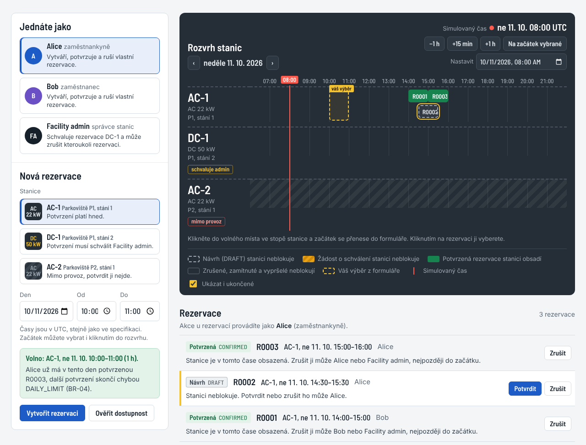

# Rezervace nabíjecích stanic pro elektromobily

Týmový projekt předmětu SWI, tým **SW-DEV-AJVZMPIA**: Viacheslav Zlobin, Maksym Panfilov, Aleksej Južaninov, Ivan Akulovich.
Repozitář: <https://github.com/alexejjuzaninov/EC-reservationSystem>

Firemní nabíjecí stanice pro elektromobily jsou omezený zdroj. Zaměstnanec si předem rezervuje časové okno na jedné stanici, aby po příjezdu nemusel čekat. Zaměstnanec, který jezdí elektromobilem, je tedy přímo zákazník systému: sám si najde volnou stanici a rezervuje ji. Facility admin rezervace nevytváří, rozhoduje o provozu stanic. Stanice je **exkluzivní Resource**: v jednom okamžiku ji smí mít potvrzenou nejvýše jedna rezervace.

**▶ [Otevřít webovou ukázku](https://alexejjuzaninov.github.io/EC-reservationSystem/app/)**: běží přímo v prohlížeči, nic se neinstaluje. Návod je v [`app/README.md`](app/README.md). Ukázka je artefakt C02: pravidla v ní jsou kopie pravidel z `reservation.py` přepsaná do JavaScriptu (driver D5 pro C03).

[](https://alexejjuzaninov.github.io/EC-reservationSystem/app/)

## Kde co najdete

| Cvičení | Co | Kde |
|---|---|---|
| C01 | Project Frame, future pressure | [`docs/intent-and-change.md`](docs/intent-and-change.md) |
| C01 | engineering spike (kód a testy) | [`spike/`](spike/) |
| C01 | evidence a rozhodnutí spike | [`docs/evidence-and-evolution.md`](docs/evidence-and-evolution.md), část C01 Engineering Spike |
| C01 | rozhodnutí o stacku | [`docs/architecture-and-decisions.md`](docs/architecture-and-decisions.md), část C01 |
| C01 | change + review, walking skeleton | tento README, část [C01](#c01-rámec-projektu) |
| C02 | specifikace v0.1 a v0.2, diagramy, rozhodnutí týmu | [`docs/specification.md`](docs/specification.md) |
| C02 | běžící aplikace a příklady ověření | [`reservation.py`](reservation.py), webová ukázka [`app/index.html`](app/index.html) |
| C02 | evidence specifikace → aplikace | [`docs/evidence-and-evolution.md`](docs/evidence-and-evolution.md), část Evidence C02 |
| C03 | část A (AS-IS), drivery, ADR-01, pohledy G a H, cross-view kontrola, delta, ověření | [`docs/architecture-and-decisions.md`](docs/architecture-and-decisions.md), části C03 |
| C03 | diagramy architektury (zdroje `.puml`) | [`docs/diagrams/`](docs/diagrams/), soubory `c03-*` |
| C03 | walking skeleton (FastAPI + PostgreSQL) a jeho testy | [`src/`](src/) |
| C03 | evidence architektury | [`docs/evidence-and-evolution.md`](docs/evidence-and-evolution.md), část C03 |
| C05 | Detailed Design | [`docs/architecture-and-decisions.md`](docs/architecture-and-decisions.md), část C05 |
| C05 | unit/component testy odvozené z DD | [`tests/test_allocation.py`](tests/test_allocation.py) |
| C05 | evidence DD | [`docs/evidence-and-evolution.md`](docs/evidence-and-evolution.md), část C05 |
| C02, C05 | mutační kontrola testů | [`tools/mutation_check.py`](tools/mutation_check.py) |
| C01 | odevzdaný dokument | [`docs/SWI-C01-reservation-system.pdf`](docs/SWI-C01-reservation-system.pdf) |

## Rychlý start

Aplikace C02 potřebuje jen Python 3.10 nebo novější, žádné další balíčky. Na Windows místo `python` použijte spouštěč `py`:

```bash
python reservation.py test                  # 40 příkladů ověření ze specifikace, výsledek PASS/FAIL
python reservation.py demo                  # krátká ukázka všech operací
python -m unittest discover -s tests -v     # 13 unit/component testů z Detailed Design (C05)
python tools/mutation_check.py              # ověří, že testy odhalí 7 záměrně pokažených pravidel
```

Webová ukázka: soubor `app/index.html` stačí otevřít v prohlížeči (dvojklik), nepotřebuje server ani internet.

Engineering spike z C01 (PostgreSQL) se spouští zvlášť. Potřebuje Docker (na Windows Docker Desktop, který vyžaduje WSL 2: `wsl --install` v PowerShellu spuštěném jako správce) a Python 3.12.

Nejdřív databáze (po `docker run` počkejte pár sekund, než PostgreSQL naběhne):

```bash
docker run --name swi-db -e POSTGRES_PASSWORD=swi -e POSTGRES_DB=reservations -p 5432:5432 -d postgres:16
docker exec swi-db psql -U postgres -c "CREATE DATABASE reservations_test;"
```

Potom virtuální prostředí, závislosti a testy. Windows (PowerShell, Python přes spouštěč `py`):

```powershell
cd spike
py -3.12 -m venv .venv
.venv\Scripts\python -m pip install -r requirements.txt
.venv\Scripts\python -m pytest -v
```

Linux / macOS:

```bash
cd spike
python3 -m venv .venv
.venv/bin/python -m pip install -r requirements.txt
.venv/bin/python -m pytest -v
```

Očekávaný výsledek: `4 passed`. Po restartu počítače stačí databázi znovu spustit příkazem `docker start swi-db`.

### Walking skeleton (C03, složka `src/`)

Používá stejnou databázi `swi-db` jako spike; testovací databázi `reservations_app_test` si testy vytvoří samy. Windows (PowerShell):

```powershell
cd src
py -3.12 -m venv .venv
.venv\Scripts\python -m pip install -r requirements.txt
.venv\Scripts\python -m pytest                              # očekáváno: 54 passed
.venv\Scripts\python -m uvicorn reservations.main:app       # server na http://127.0.0.1:8000, dokumentace API na /docs
```

Linux / macOS: totéž s `python3 -m venv .venv` a `.venv/bin/python`. Server používá databázi `reservations` (proměnná `DATABASE_URL`) a při startu si vytvoří tabulky a ukázková data (alice, bob, admin; AC-1, DC-1, AC-2). Uživatel se předává hlavičkou `X-User-Id`, například:

```bash
curl -X POST http://127.0.0.1:8000/reservations -H "X-User-Id: alice" -H "Content-Type: application/json" \
     -d '{"station_id": "AC-1", "start_time": "2027-03-01T10:00:00Z", "end_time": "2027-03-01T11:00:00Z"}'
```

## Co systém dělá

| Aktér | Co dělá |
|---|---|
| Zaměstnanec | vytváří, potvrzuje a ruší **vlastní** rezervace |
| Facility admin | může zrušit **kteroukoli** rezervaci; od v0.2 schvaluje a zamítá rezervace stanic, které schválení vyžadují |
| Notification Service (externí systém) | pošle vlastníkovi e-mail, když se jeho rezervace potvrdí, zruší nebo zamítne |

Životní cyklus rezervace v kostce: vytvořená rezervace je jen **návrh (DRAFT)** a stanici neblokuje. Stanici obsadí až **potvrzená rezervace (CONFIRMED)**. U stanice se schválením potvrzení jen požádá o schválení (**PENDING_APPROVAL**) a Facility admin ho schválí, nebo zamítne (**REJECTED**). Pokud do začátku rezervace nikdo nerozhodne, žádost vyprší (**EXPIRED**). Zrušená rezervace (**CANCELLED**) v systému zůstává.

Ukázková data v aplikaci i v testech:

| Stanice | Typ | Umístění | Vlastnost |
|---|---|---|---|
| AC-1 | AC 22 kW | Parkoviště P1, stání 1 | potvrzení platí hned |
| DC-1 | DC 50 kW | Parkoviště P1, stání 2 | od v0.2 vyžaduje schválení Facility adminem |
| AC-2 | AC 22 kW | Parkoviště P2, stání 1 | mimo provoz |

Uživatelé: `alice` a `bob` (zaměstnanci), `admin` (Facility admin). Ukázkový čas začíná v neděli 11. 10. 2026 v 08:00 UTC.

Úplná pravidla, požadavky, operace a diagramy jsou v [`docs/specification.md`](docs/specification.md). Platná verze pro C03 a CP1 je **Specification Baseline v0.2**.

## C01: rámec projektu

| Položka | Hodnota |
|---|---|
| Tým | SW-DEV-AJVZMPIA |
| Členové | Viacheslav Zlobin, Maksym Panfilov, Aleksej Južaninov, Ivan Akulovich |
| Repozitář | <https://github.com/alexejjuzaninov/EC-reservationSystem> |
| Rezervovaný Resource | nabíjecí stanice pro elektromobily (EV charging station) |
| Vlastní business rule | uživatel smí mít nejvýše jednu potvrzenou rezervaci za kalendářní den a ta smí trvat nejvýše 4 hodiny |
| External boundary | Notification Service |
| Future pressure | R: Risk / Higher consequence (placené veřejné stanice) |
| Technologický stack | Python 3.12, FastAPI, SQLAlchemy, PostgreSQL, pytest |

Plné znění Project Frame a future pressure je v [`docs/intent-and-change.md`](docs/intent-and-change.md).

### Change a review

| Krok | Provedení |
|---|---|
| Issue | [#3 C01 engineering spike](https://github.com/alexejjuzaninov/EC-reservationSystem/issues/3): vynutit BR-02 i při souběhu |
| Autor změny | Aleksej Južaninov, větev `c01-db-overlap-constraint` (commity `238e8ce`, `a809456`) |
| Reviewer | Maksym Panfilov (GitHub `Makusu1`), [Pull Request #4](https://github.com/alexejjuzaninov/EC-reservationSystem/pull/4), stav Approved před mergem |
| Obsah review | spike spuštěn lokálně (Docker Desktop, PostgreSQL 16, Python 3.13): `4 passed`; po dočasném zakomentování EXCLUDE constraintu 2 failed (`assert 2 == 1`, `DID NOT RAISE IntegrityError`), po vrácení opět `4 passed`; navazující interval projde |
| Integrace | PR #4 sloučen do `main` merge commitem `ac72d92`, issue #3 se tím uzavřel |

### Engineering spike: varianta A (persistence)

Rezervace se ukládá do skutečné databáze PostgreSQL, znovu se načte a ověří se vynucení pravidla o překryvu. Kód je ve složce `spike/` (příkazy viz [Rychlý start](#rychlý-start)).

Sekvenčně kontrola v service vrstvě překryv zachytí a navazující rezervace projde (`spike/tests/test_overlap.py`). Při souběhu ale **obě** rezervace skončily CONFIRMED (`AssertionError: assert 2 == 1`, `spike/tests/test_concurrency_risk.py`), protože databáze sama žádné omezení neměla. Proto spike doplnil EXCLUDE constraint v PostgreSQL; testy `spike/tests/test_db_constraint.py` ověřují, že databáze překryv odmítne i bez service vrstvy a navazující časy povolí.

Otázka, postup, pozorovaný výsledek, rozhodnutí, výstup `pytest` po změně (`4 passed`) a kontrola, že testy při pokaženém kódu opravdu selžou, jsou v [`docs/evidence-and-evolution.md`](docs/evidence-and-evolution.md), část C01 Engineering Spike.

### Walking skeleton pro CP1

Definice z C01, spustitelná po C03:

```text
POST /reservations
  → validate      (Pydantic schema + business rules)
  → persist       (SQLAlchemy → PostgreSQL)
  → return reservation ID
  → automated check (pytest: POST vrátí 201 a ID, záznam je v DB)
```

Stav: **implementováno** ve složce `src/` (C03). Automatická kontrola je `src/tests/test_walking_skeleton.py`; spuštění viz [Rychlý start](#walking-skeleton-c03-složka-src). Skeleton nakonec obsahuje všech pět operací z C02, nejen `POST /reservations`, se stejnými 40 příklady ověření. Architektura a ADR-01 jsou v `docs/architecture-and-decisions.md`. Aplikace C02 (`reservation.py`) zůstává jako zmrazený artefakt C02.

### Rozhodnutí o stacku

Python 3.12 + FastAPI + SQLAlchemy + PostgreSQL + pytest místo výchozího Java / Spring Boot. Tým má s Pythonem zkušenosti, se Springem nikdo. Cena: stack si podporujeme sami, bez referenčního nastavení vyučujícího. FastAPI dává validaci (Pydantic) a OpenAPI, PostgreSQL zůstává z doporučeného stacku. Plné znění je v [`docs/architecture-and-decisions.md`](docs/architecture-and-decisions.md).
