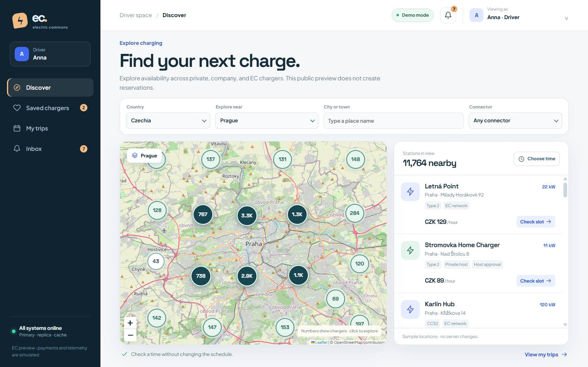
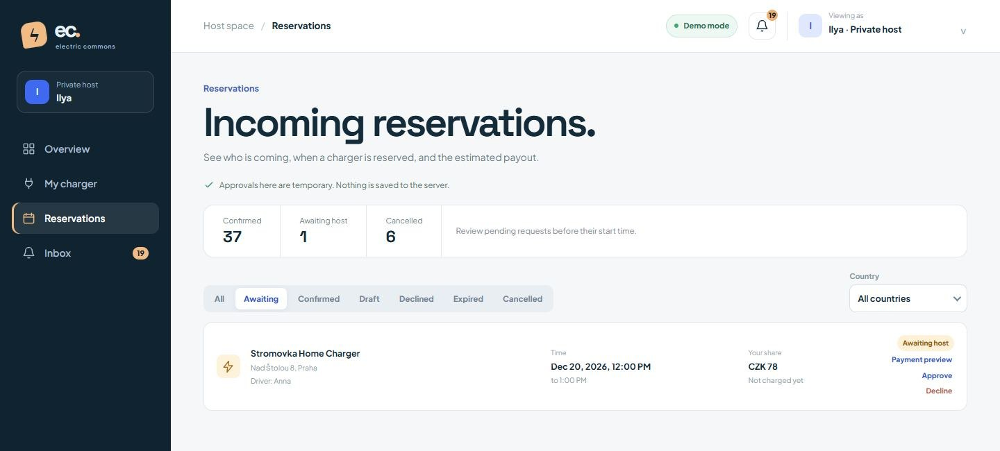

# EC Reservation

**Nabíjení blíž lidem.** EC provozuje vlastní stanice a propojuje řidiče se soukromými i firemními vlastníky. Řidič najde místo na mapě, vybere termín a sleduje rezervaci; vlastník může žádost předem schválit. EC získává provizi z partnerských rezervací.

## Co prototyp ukazuje

- **Řidič:** mapa Česka a USA, filtry, dostupnost, rezervace, oblíbené stanice a oznámení.
- **Vlastník a firma:** vlastní stanice, rozvrh, žádosti ke schválení a přehled výnosu.
- **Správce:** moderace stanic, katalog, rezervace a simulovaná telemetrie.

Prototyp používá Spring Boot, PostgreSQL/PostGIS, čtecí repliku, Redis a Flyway. Platby a telemetrie jsou simulované. [Veřejný náhled](https://ec.vezem1r.com) umožňuje procházet role a vyzkoušet rozhodnutí v prohlížeči; tyto změny se neukládají.

**Lokální spuštění:** `docker compose up -d --build`, potom otevřít `http://localhost:18080`. Účet se pro ukázku přepíná v horní liště.

České podklady k předmětu, diagramy a obrazovky jsou v [zadani](zadani/README.md).
