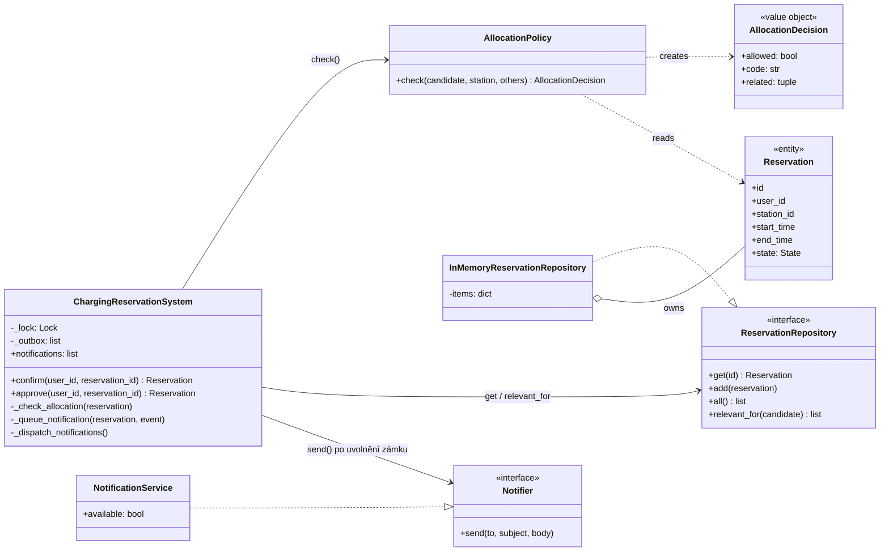
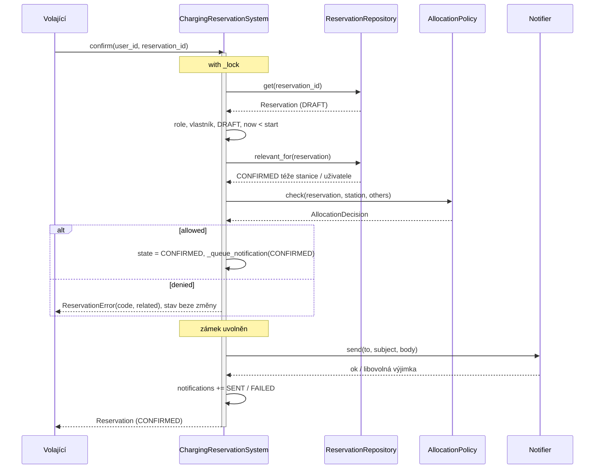

# Architecture and Decisions

## C01: Stack decision

We chose Python 3.12 + FastAPI + SQLAlchemy + PostgreSQL + pytest instead of the default Java
/ Spring Boot stack. Reason: the team already works with Python, while no member has practical
experience with Spring. A familiar stack lets us spend C01 on the reservation domain and on the
engineering spike rather than on framework setup.

Trade-off: we support this stack ourselves, without the teacher's reference setup. FastAPI gives us
request validation (Pydantic) and an OpenAPI schema out of the box, which covers what the CP1
walking skeleton needs. PostgreSQL is kept from the recommended stack, so the persistence layer
stays comparable to other teams.

## C02: výchozí stav pro C03

Aplikace C02 (`reservation.py`) je záměrně jednoduchá: jeden modul, data jen v paměti, jeden zámek pro všechny operace. Webová ukázka `app/index.html` obsahuje stejná pravidla přepsaná do JavaScriptu. Architektonické drivery D1 až D5, které z C02 vyplynuly, jsou v `docs/specification.md` (část Dopad změny C02) a v `docs/evidence-and-evolution.md`. Architektura z C03 se doplní sem.

## C03 Část A: AS-IS realizace scénáře Confirm Reservation

Stav kódu: commit `af2723f`. Odkazy `reservation.py:řádek` platí pro tento commit. Sledujeme Python aplikaci `reservation.py`; webová ukázka `app/index.html` obsahuje stejnou logiku podruhé (nález 5).

### A1. Sledovaný scénář

| Položka | Hodnota |
|---|---|
| Scénář / operace | OP-03 Confirm Reservation, stanice bez schválení (AC-1): DRAFT → CONFIRMED |
| Požadavky | REQ-03, REQ-04, REQ-09 |
| Pravidla / invarianty | BR-02 (nepřekrývání CONFIRMED), BR-04 (denní limit), BR-01 (polootevřené intervaly) |
| Baseline | v0.2 |

### A2. Hlavní průchod scénáře v kódu

| Krok scénáře z C02 | Realizace v kódu | Doklad |
|---|---|---|
| přijmout požadavek na potvrzení | `ChargingReservationSystem.confirm(user_id, reservation_id)`; HTTP API zatím není, volá se přímo z `demo()` a z testů | `reservation.py:198`, `:880`; runtime `python reservation.py demo`: „alice potvrdí R0001 -> R0001 CONFIRMED“ |
| serializovat vůči ostatním operacím (REQ-04) | `with self._lock:` kolem celé operace | `reservation.py:199`, zámek `:139`; test „dvě souběžná potvrzení -> právě jedno CONFIRMED“ |
| ověřit roli žadatele | `_require_role(user_id, Role.EMPLOYEE)` | `reservation.py:201`, `:371` |
| načíst Reservation | `_get_reservation()`: vyhledání v `self.reservations` | `reservation.py:202`, `:385`, slovník `:143` |
| ověřit vlastníka | `reservation.user_id != user_id` → `UNAUTHORIZED` | `reservation.py:203–204`; test „cizí rezervace -> UNAUTHORIZED“ |
| ověřit, že přechod je povolený | stav musí být DRAFT, jinak `INVALID_STATE`; rezervace nesmí začít, jinak `TOO_LATE` | `reservation.py:205–210`; testy „už potvrzená -> INVALID_STATE“, „po začátku rezervace -> TOO_LATE“ |
| rozhodnout, zda je potřeba schválení (BR-05) | `requires_approval` → PENDING_APPROVAL; pro AC-1 se nevětví | `reservation.py:211–214` |
| vyhodnotit konflikt | `_check_allocation()`: provoz stanice, `_confirmed_overlaps()` (BR-02), `_confirmed_same_day()` (BR-04) | `reservation.py:215`, `:280–299`, `:301–323` |
| změnit stav | `reservation.state = State.CONFIRMED` | `reservation.py:218` |
| uložit výsledek | samostatné uložení neexistuje: změní se objekt ve slovníku v paměti procesu | `reservation.py:143`, `:218`; test „volný DRAFT -> CONFIRMED + e-mail“ |
| poslat e-mail (REQ-09) | `_notify()` → `NotificationService.send()`, uvnitř zámku | `reservation.py:219`, `:342–362`, `:96–99` |
| vrátit výsledek | vrací objekt `Reservation` | `reservation.py:220` |

### A3. Chybová větev: konflikt → potvrzení odmítnuto

| Co říká v0.2 | Kde se podmínka zjistí | Kde se rozhodne výsledek | Co dostane volající |
|---|---|---|---|
| překryv s CONFIRMED rezervací téže stanice → odmítnout, rezervace zůstává DRAFT (REQ-03, BR-02) | `_confirmed_overlaps()` projde všechny rezervace ve slovníku a vybere CONFIRMED téže stanice s `overlaps()` (`reservation.py:301–311`, `:119–121`) | `_check_allocation()` vyhodí `ReservationError("OVERLAP", …, [id])` (`reservation.py:284–292`); stav se předtím nemění, zámek uvolní `with` | výjimku `ReservationError` s `code="OVERLAP"`, zprávou a `related=["R0001"]`; rezervace zůstává DRAFT |

Doklad: test „překryv s potvrzenou -> OVERLAP, zůstává DRAFT“; runtime `demo`: „bob potvrdí R0002 -> OVERLAP (R0001)“.

Nálezy, kde se implementace liší od v0.2 nebo od C01:

| # | Specifikace | Implementace | Doklad |
|---|---|---|---|
| 1 | REQ-04: ze souběžných konfliktních potvrzení nejvýše jedno CONFIRMED | splněno jen uvnitř jednoho procesu: `threading.Lock` a data v paměti; dva procesy by zámek nesdílely | `reservation.py:139`, `:143`, `:199`; spike nad PostgreSQL bez zámku: `assert 2 == 1` (`spike/tests/test_concurrency_risk.py`) |
| 2 | C01: Notification Service „může být pomalá“; REQ-09: e-mail nesmí určovat výsledek | `send()` se volá uvnitř zámku, pomalá služba zdrží všechny operace | runtime: při `send()` trvajícím 2 s čekala `check_availability` na jiné stanici 1,90 s |
| 3 | REQ-09: výpadek služby nezmění výsledek a nedoručený e-mail se zapíše | ošetřena jen `NotificationUnavailable`; jiná chyba (např. `TimeoutError`) projde k volajícímu, i když rezervace už je CONFIRMED, a do `notifications` se nic nezapíše | runtime: volající dostal `TimeoutError`, stav `CONFIRMED`, 0 záznamů; `reservation.py:358–361` |
| 4 | C01 Persistent state, driver D2 | stav není trvalý: po skončení procesu zmizí | `reservation.py:143`; každý běh `demo` začíná znovu od R0001 |
| 5 | jedno místo pro pravidlo (pressure R z C01) | pravidla jsou ještě jednou v JavaScriptu v `app/index.html` | `app/index.html` `confirm()` a `_checkAllocation()`; shodu automaticky nic nehlídá |
| 6 | identita uživatele (TBD-01) | `user_id` je obyčejný řetězec od volajícího, nic ho neověřuje | `reservation.py:198`, `:371` |

### A4. Hlavní části implementace

Aplikace je malá, proto úroveň tříd. Úložiště a zámek nejsou samostatné třídy, ale atributy `ChargingReservationSystem`; v tabulce jsou zvlášť, protože ve scénáři hrají vlastní roli.

| Část implementace | Typ / obsah | Role v tomto scénáři | Doklad |
|---|---|---|---|
| Vstupní bod | «module functions» `main()`, `demo()`, `run_verification()` a testovací funkce | zavolá `confirm()` | `reservation.py:863`, `:896` |
| ChargingReservationSystem | «class» | autorizace, kontrola stavu a času, BR-02, BR-04, změna stavu, spuštění e-mailu | `reservation.py:130–400` |
| In-memory store | «atribut» `reservations: Dict[str, Reservation]` + «dataclass» `Reservation`, `ChargingStation`, `User` | drží rezervace a jejich stav | `reservation.py:143`, `:47–72` |
| Lock | «atribut» `_lock: threading.Lock` | serializuje všechny operace (REQ-04) | `reservation.py:139`, `:199` |
| NotificationService | «class», simulace externí služby | přijme e-mail, nebo vyhodí `NotificationUnavailable` | `reservation.py:89–99` |

### A5. Stav, změna stavu a pravidlo

**Stav**

| Otázka | Odpověď | Doklad |
|---|---|---|
| Kde je stav Reservation trvale uložen? | Nikde trvale. Atribut `Reservation.state` objektu ve slovníku `ChargingReservationSystem.reservations` v paměti procesu. | `reservation.py:65–72`, `:143` |
| Který kód rozhoduje a provádí přechod? | `ChargingReservationSystem.confirm()` rozhoduje (kontroly `:203–215`) i provádí přiřazení `:218`. Stejný přechod do CONFIRMED provádí i `approve()` (`:230`). | `reservation.py:198–220`, `:223–232` |

**Pravidlo BR-02**

| Otázka | Odpověď | Doklad |
|---|---|---|
| Kde se zjistí podmínka pravidla? | `_confirmed_overlaps()` s funkcí `overlaps()` | `reservation.py:301–311`, `:119–121` |
| Kde se podle výsledku rozhodne? | `_check_allocation()` vyhodí `OVERLAP`; volá ho `confirm()` i `approve()`. Stejnou podmínku čte i `check_availability()`, ta ale jen hlásí UNAVAILABLE. | `reservation.py:287–292`, `:215`, `:229`, `:193` |
| Kde se provede výsledná změna stavu? | při konfliktu žádná; bez konfliktu `confirm()` `:218`, ve v0.2 `approve()` `:230` | `reservation.py:218`, `:230` |

Totéž rozhodnutí dělá ještě `app/index.html` (`_checkAllocation()`), viz nález 5.

### A6. Relevantní závislosti

| Závislost | Kde se napojuje na náš kód | Která část zná její technické API | Doklad |
|---|---|---|---|
| databáze | ve scénáři není; stav je ve slovníku v paměti. PostgreSQL zatím používá jen `spike/` | žádná | `reservation.py:143`; `spike/src/db.py` |
| Notification Service | konstruktor přijme `notifier`, `_notify()` volá `send(to, subject, body)` | jen `NotificationService`; skutečné HTTP volání neexistuje, třída službu simuluje | `reservation.py:140`, `:359`, `:96–99` |
| IdP | není; `user_id` předává volající bez ověření | žádná | `reservation.py:198`, `:371` |
| hodiny | konstruktor přijme `clock`, čte ho `now()`; testy dosazují `Clock` | `ChargingReservationSystem.now()` | `reservation.py:148`, `:410–415` |

### A7. AS-IS strukturální diagram

```text
+------------------------------- Application code -------------------------------+
|                                                                                |
|  [Vstupní bod]  «module functions»                                             |
|  role: zavolá potvrzení rezervace                                              |
|      |                                                                         |
|      | confirm(user_id, reservation_id)                                        |
|      v                                                                         |
|  [ChargingReservationSystem]  «class»                                          |
|  role: zamkne operaci, ověří oprávnění, stav, čas,                             |
|        BR-02 a BR-04, změní stav, spustí e-mail                                |
|     |                    |                       |                             |
|     | acquire/release    | get / filter /        | send(to, subject, body)     |
|     |                    | set state             |                             |
|     v                    v                       v                             |
|  [Lock]               [In-memory store]       [NotificationService]            |
|  «atribut _lock»      «atribut reservations»  «class, simulace»                |
|  role: serializuje    role: drží rezervace    role: zastupuje                  |
|  všechny operace      a jejich stav           e-mailovou službu                |
|                                                                                |
+--------------------------------------------------------------------------------+

  Mimo Application code (scénář je dnes skutečně nepoužívá):
  [PostgreSQL]            «database»         stav je jen v paměti, PostgreSQL je zatím jen ve spike/
  [Notification Service]  «external system»  skutečné HTTP volání neexistuje, NotificationService ho simuluje
```

Obsah bloků:

- Vstupní bod: `main()`, `demo()`, `run_verification()` a testovací funkce `c_confirm_*`
- ChargingReservationSystem: `confirm()`, `_check_allocation()`, `_confirmed_overlaps()`, `_confirmed_same_day()`, `_expire_overdue()`, `_require_role()`, `_get_reservation()`, `_notify()`
- In-memory store: atribut `reservations`, dataclass `Reservation`, `ChargingStation`, `User`
- Lock: atribut `_lock`
- NotificationService: `send()`, výjimka `NotificationUnavailable`

### A8. Otázka pro další C03

| Položka | Obsah |
|---|---|
| Otázka | Kde a jak se bude vynucovat BR-02 a REQ-04, až stav rezervací přejde z paměti procesu do PostgreSQL a aplikace poběží jako FastAPI (walking skeleton z C01)? |
| Doklad | Dnes souběh hlídá jen `threading.Lock` nad slovníkem v paměti (`reservation.py:139`, `:143`, `:199`). Kontrola a zápis nad databází bez zámku pustí obě potvrzení: spike `assert 2 == 1`. Totéž pravidlo navíc rozhoduje `approve()` a kopie v `app/index.html`. |
| Proč je důležitá | BR-02 musí platit i při souběhu a ve více procesech. Podle pressure R z C01 znamená dvojí rezervace placenou stanici obsazenou někým jiným, tedy refundace a stížnosti. |

Další nálezy pro návrh (nálezy 2 a 3): odeslání e-mailu by mělo proběhnout mimo zámek a mimo rozhodnutí o stavu.

### A9. Použití AI

AI posloužila k navigaci v kódu, návrhu trace a první verzi diagramu. Zapsaná tvrzení jsou ověřená v kódu (čísla řádků pro commit `af2723f`), testy `python reservation.py test` (40/40), během `python reservation.py demo` a dvěma runtime pokusy u nálezů 2 a 3.

## C05 Detailed Design

### Selected architecture unit

| Položka | Hodnota |
|---|---|
| Selected architecture unit / responsibility | **Přidělení stanice (Reservation allocation):** rozhodnutí, zda se rezervace smí stát CONFIRMED, a provedení tohoto přechodu včetně notifikace |
| Related requirement(s) | REQ-03, REQ-04, REQ-06, REQ-09 |
| Related scenario(s) | OP-03 Confirm Reservation (stanice bez schválení), OP-05 Approve Reservation |
| Relevant business rule(s) | BR-01 (polootevřené intervaly), BR-02 (nepřekrývání CONFIRMED), BR-04 (denní limit podle data začátku v UTC) |
| Hranice jednotky | patří sem rozhodnutí o alokaci, data potřebná k rozhodnutí, zápis stavu a odeslání e-mailu; nepatří sem vytvoření rezervace, kontrola dostupnosti ani schvalovací workflow mimo samotné přidělení |

Proč tato jednotka: v C03 vyšlo, že právě zde je hlavní logika (BR-02, BR-04) a tři nálezy: rozhodnutí je zapletené do jedné velké třídy, e-mail se posílá pod zámkem (nález 2) a neočekávaná chyba e-mailu doběhne k volajícímu (nález 3). Otázka A8 (BR-02 po přechodu na PostgreSQL) potřebuje mezi logikou a daty jasný kontrakt.

### Detailed responsibilities

| Detailed responsibility | Why is it needed? |
|---|---|
| serializovat rozhodnutí o alokaci | REQ-04: ze souběžných konfliktních potvrzení nejvýše jedno CONFIRMED |
| ověřit oprávnění a výchozí stav (vlastník a DRAFT, resp. Facility admin a PENDING_APPROVAL, `now < start`) | přechod je povolený jen z konkrétního stavu a jen oprávněnému aktérovi |
| načíst data potřebná k rozhodnutí (CONFIRMED rezervace téže stanice a téhož uživatele) | BR-02 a BR-04 se vyhodnocují nad potvrzenými rezervacemi; s PostgreSQL to bude jeden dotaz |
| rozhodnout o alokaci: provoz stanice, BR-02, BR-04, v pevném pořadí | jedno místo pravidla pro Confirm i Approve (pressure R z C01) |
| provést přechod do CONFIRMED | jediný okamžik vzniku alokace |
| odeslat e-mail mimo kritickou sekci a zapsat výsledek | REQ-09: e-mail nesmí určovat ani zdržovat výsledek |

### Design elements and ownership

| Responsibility | Owner | State/data | Why here? |
|---|---|---|---|
| serializace, oprávnění, výchozí stav, provedení přechodu | `ChargingReservationSystem.confirm()` / `approve()` (application service) | `_lock: threading.Lock`; mění `Reservation.state` | koordinuje spolupracovníky a drží transakční hranici operace |
| rozhodnutí o alokaci | `AllocationPolicy.check()` (policy, čistá funkce) | žádný vlastní stav; vstupem je kandidát, stanice a ostatní rezervace | testovatelné bez hodin, zámku i úložiště; stejné pro Confirm i Approve |
| výsledek rozhodnutí | `AllocationDecision` (value object, frozen) | `allowed`, `code`, `related` | rozhodnutí je hodnota, ne výjimka; volající sám určí, jak ji přeloží |
| data k rozhodnutí | `ReservationRepository` (interface) a `InMemoryReservationRepository` | slovník `items: Dict[str, Reservation]` | systém zná jen kontrakt; v CP1 přibude `SqlReservationRepository` bez změny policy |
| odeslání e-mailu | `_queue_notification()` + `_dispatch_notifications()`, rozhraní `Notifier` | fronta `_outbox`, log `notifications` | e-mail se připraví pod zámkem (konzistentní data), odejde až po jeho uvolnění |
| perzistentní stav rezervace | `Reservation` (dataclass) | `id, user_id, station_id, start_time, end_time, created_at, state` | entita z Project Frame C01 |

### Key interface(s) / contract(s)

```text
<<class>> AllocationPolicy
check(candidate: Reservation, station: ChargingStation, others: Iterable[Reservation]) : AllocationDecision
```

| Contract | |
|---|---|
| Preconditions | `candidate` má platný interval (`start < end`), `station` je stanice kandidáta; `others` smí obsahovat rezervace v libovolném stavu i kandidáta samotného |
| Postconditions | vrací `AllocationDecision`; `allowed = True` právě když je stanice v provozu, kandidát se nepřekrývá s žádnou CONFIRMED rezervací téže stanice (BR-01, BR-02) a vlastník nemá jinou CONFIRMED se stejným datem začátku v UTC (BR-04); jinak `allowed = False`, `code` je první porušené pravidlo v pořadí INACTIVE_STATION → OVERLAP → DAILY_LIMIT a `related` obsahuje id všech konfliktních rezervací |
| Side effects | žádné: nemění vstupy, nečte hodiny, nic neukládá |
| Failures | žádné výjimky; porušení pravidla je hodnota `INACTIVE_STATION`, `OVERLAP` nebo `DAILY_LIMIT` |

```text
<<interface>> ReservationRepository
get(id) : Reservation | None
add(reservation) : None
all() : List[Reservation]
relevant_for(candidate) : List[Reservation]
```

Kontrakt `relevant_for`: vrací všechny CONFIRMED rezervace téže stanice **nebo** téhož uživatele, bez kandidáta. Je to přesně množina, kterou potřebuje `AllocationPolicy`; SQL implementace ji vrátí jedním dotazem.

```text
<<interface>> Notifier
send(to, subject, body) : None      — při selhání vyhodí libovolnou výjimku
```

### Focused structural view



Směr závislostí: `ChargingReservationSystem` závisí na kontraktech (`ReservationRepository`, `Notifier`) a na `AllocationPolicy`; policy nezávisí na ničem kromě entit. Implementace se dosazují v konstruktoru (`repository=`, `policy=`, `notifier=`).

### Detailed sequence

C03 (architektura): `Vstupní bod → ChargingReservationSystem → In-memory store / NotificationService`.

C05 (DD), Confirm na stanici bez schválení:



### Important methods / operations

| | `AllocationPolicy.check()` | `ChargingReservationSystem.confirm()` | `_dispatch_notifications()` |
|---|---|---|---|
| Responsibility | rozhodnout o alokaci | provést přechod DRAFT → CONFIRMED | doručit připravené e-maily |
| Input | kandidát, stanice, ostatní rezervace | `user_id`, `reservation_id` | fronta `_outbox` |
| Output | `AllocationDecision` | `Reservation` | nic |
| Preconditions | platný interval kandidáta | rezervace existuje | volá se bez drženého zámku |
| Postconditions | viz kontrakt výše | úspěch: CONFIRMED a jeden e-mail ve frontě; neúspěch: stav i fronta beze změny | fronta prázdná, každý e-mail má v `notifications` záznam SENT nebo FAILED |
| Side effects | žádné | mění `Reservation.state`, plní `_outbox`, spustí odeslání | volá `Notifier.send()` |
| Failure behavior | žádné výjimky, porušení vrací jako hodnotu | `ReservationError`: UNAUTHORIZED, UNKNOWN_RESERVATION, INVALID_STATE, TOO_LATE, INACTIVE_STATION, OVERLAP, DAILY_LIMIT | jakákoli výjimka z `send()` → FAILED, k volajícímu nedoběhne |

`approve()` je stejná operace s jinou podmínkou výchozího stavu (Facility admin, PENDING_APPROVAL, vypršení podle BR-06) a volá stejné `_check_allocation()` → `AllocationPolicy.check()`.

### Algorithm / decision logic

```text
check(candidate, station, others):
    if not station.active:                         return deny(INACTIVE_STATION)
    confirmed = [r in others | r.state == CONFIRMED and r.id != candidate.id]
    overlapping = [r in confirmed | r.station_id == candidate.station_id
                   and candidate.start < r.end and r.start < candidate.end]      # BR-01, BR-02
    if overlapping:                                return deny(OVERLAP, ids(overlapping))
    same_day = [r in confirmed | r.user_id == candidate.user_id
                and utc_date(r.start) == utc_date(candidate.start)]               # BR-04
    if same_day:                                   return deny(DAILY_LIMIT, ids(same_day))
    return allow()
```

| Stanice v provozu | Překryv s CONFIRMED téže stanice | CONFIRMED vlastníka v ten den | Výsledek |
|---|---|---|---|
| ne | libovolně | libovolně | INACTIVE_STATION |
| ano | ano | libovolně | OVERLAP + id |
| ano | ne | ano | DAILY_LIMIT + id |
| ano | ne | ne | allow |

### DD decisions intentionally left to code

- texty chybových hlášek (`ALLOCATION_MESSAGES`) a formát předmětu a těla e-mailu;
- generování id rezervací (`R0001`, …) a pořadí položek v `related` (pořadí v úložišti);
- testovací háček `after_checks` pro vynucení souběhu;
- webová ukázka `app/index.html` má stejná pravidla napsaná znovu v JavaScriptu (driver D5); C05 ji strukturálně neupravuje a shodu chování automaticky nic nehlídá.
