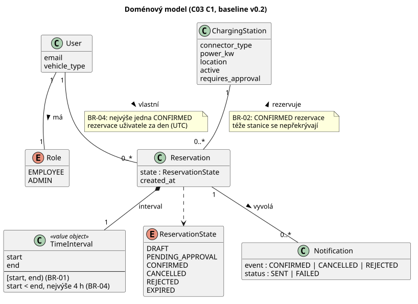
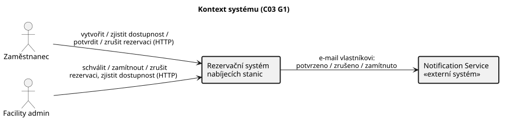
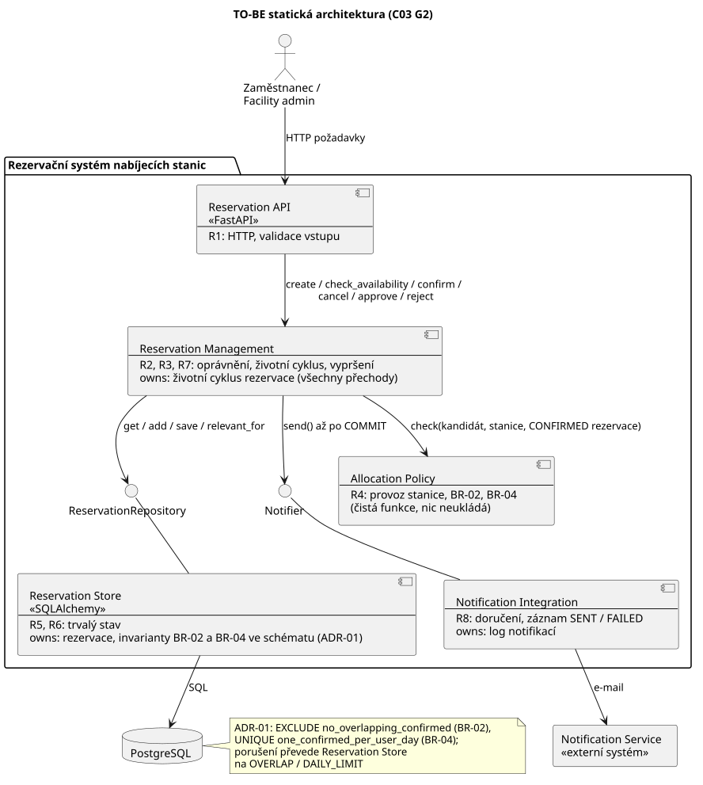
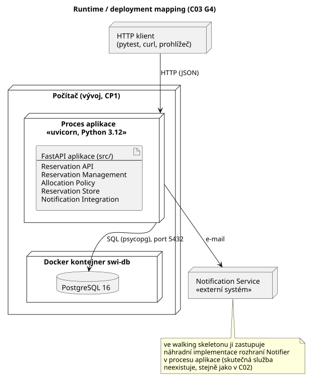
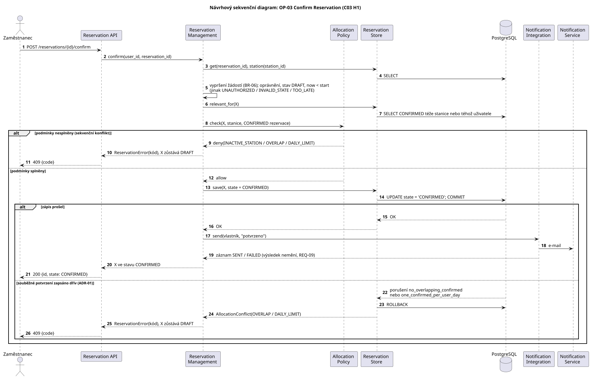
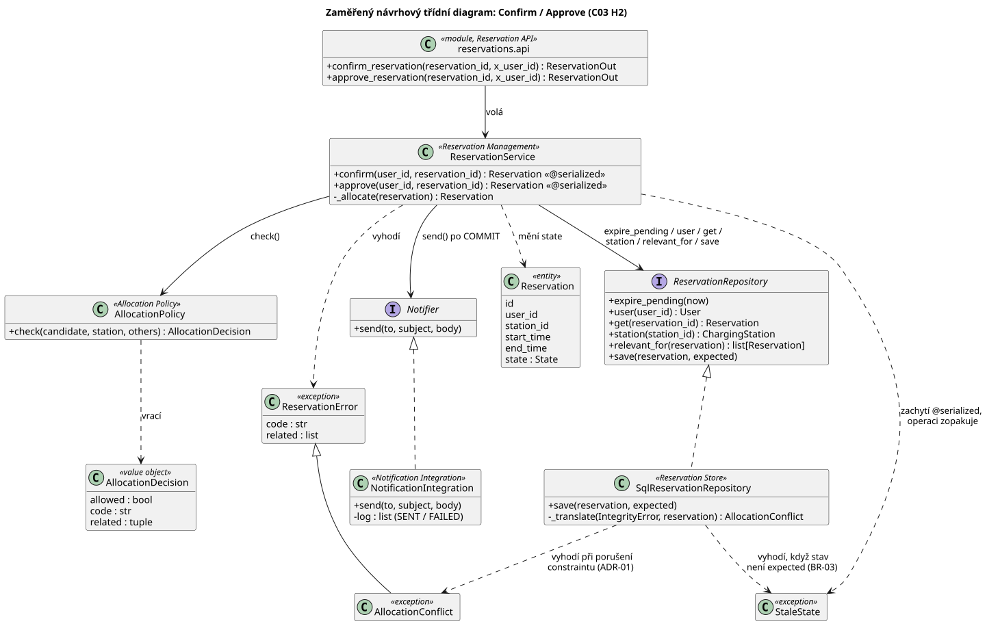
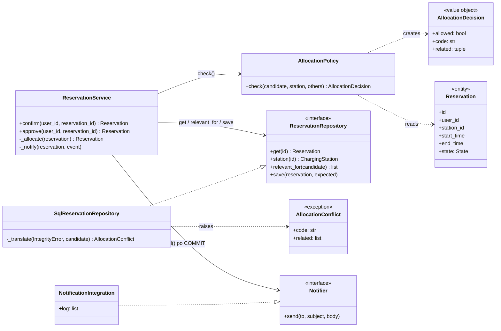

# Architecture and Decisions

## C01: Stack decision

We chose Python 3.12 + FastAPI + SQLAlchemy + PostgreSQL + pytest instead of the default Java
/ Spring Boot stack. Reason: the team already works with Python, while no member has practical
experience with Spring. A familiar stack lets us spend C01 on the reservation domain and on the
engineering spike rather than on framework setup.

Trade-off: we support this stack ourselves, without the teacher's reference setup. FastAPI gives us
request validation (Pydantic) and an OpenAPI schema out of the box, which covers what the CP1
walking skeleton needs. PostgreSQL is kept from the recommended stack, so the persistence layer
stays comparable to other teams.

## C02: výchozí stav pro C03

Aplikace C02 (`reservation.py`) je záměrně jednoduchá: jeden modul, data jen v paměti, jeden zámek pro všechny operace. Webová ukázka `app/index.html` obsahuje stejná pravidla přepsaná do JavaScriptu. Architektonické drivery D1 až D5, které z C02 vyplynuly, jsou v `docs/specification.md` (část Dopad změny C02) a v `docs/evidence-and-evolution.md`. Architektura z C03 je níže (část A a části B–L), její realizace je walking skeleton ve složce `src/`.

## C03 Část A: AS-IS realizace scénáře Confirm Reservation

Stav kódu: commit `a4e1f4e`. Odkazy `reservation.py:řádek` platí pro tento commit. Sledujeme Python aplikaci `reservation.py`; webová ukázka `app/index.html` obsahuje stejnou logiku podruhé (nález 5).

### A1. Sledovaný scénář

| Položka | Hodnota |
|---|---|
| Scénář / operace | OP-03 Confirm Reservation, stanice bez schválení (AC-1): DRAFT → CONFIRMED |
| Požadavky | REQ-03, REQ-04, REQ-09 |
| Pravidla / invarianty | BR-02 (nepřekrývání CONFIRMED), BR-04 (denní limit), BR-01 (polootevřené intervaly) |
| Baseline | v0.2 |

### A2. Hlavní průchod scénáře v kódu

| Krok scénáře z C02 | Realizace v kódu | Doklad |
|---|---|---|
| přijmout požadavek na potvrzení | `ChargingReservationSystem.confirm(user_id, reservation_id)`; HTTP API zatím není, volá se přímo z `demo()` a z testů | `reservation.py:198`, `:880`; runtime `python reservation.py demo`: „alice potvrdí R0001 -> R0001 CONFIRMED“ |
| serializovat vůči ostatním operacím (REQ-04) | `with self._lock:` kolem celé operace | `reservation.py:199`, zámek `:139`; test „dvě souběžná potvrzení -> právě jedno CONFIRMED“ |
| ověřit roli žadatele | `_require_role(user_id, Role.EMPLOYEE)` | `reservation.py:201`, `:371` |
| načíst Reservation | `_get_reservation()`: vyhledání v `self.reservations` | `reservation.py:202`, `:385`, slovník `:143` |
| ověřit vlastníka | `reservation.user_id != user_id` → `UNAUTHORIZED` | `reservation.py:203–204`; test „cizí rezervace -> UNAUTHORIZED“ |
| ověřit, že přechod je povolený | stav musí být DRAFT, jinak `INVALID_STATE`; rezervace nesmí začít, jinak `TOO_LATE` | `reservation.py:205–210`; testy „už potvrzená -> INVALID_STATE“, „po začátku rezervace -> TOO_LATE“ |
| rozhodnout, zda je potřeba schválení (BR-05) | `requires_approval` → PENDING_APPROVAL; pro AC-1 se nevětví | `reservation.py:211–214` |
| vyhodnotit konflikt | `_check_allocation()`: provoz stanice, `_confirmed_overlaps()` (BR-02), `_confirmed_same_day()` (BR-04) | `reservation.py:215`, `:280–299`, `:301–323` |
| změnit stav | `reservation.state = State.CONFIRMED` | `reservation.py:218` |
| uložit výsledek | samostatné uložení neexistuje: změní se objekt ve slovníku v paměti procesu | `reservation.py:143`, `:218`; test „volný DRAFT -> CONFIRMED + e-mail“ |
| poslat e-mail (REQ-09) | `_notify()` → `NotificationService.send()`, uvnitř zámku | `reservation.py:219`, `:342–362`, `:96–99` |
| vrátit výsledek | vrací objekt `Reservation` | `reservation.py:220` |

### A3. Chybová větev: konflikt → potvrzení odmítnuto

| Co říká v0.2 | Kde se podmínka zjistí | Kde se rozhodne výsledek | Co dostane volající |
|---|---|---|---|
| překryv s CONFIRMED rezervací téže stanice → odmítnout, rezervace zůstává DRAFT (REQ-03, BR-02) | `_confirmed_overlaps()` projde všechny rezervace ve slovníku a vybere CONFIRMED téže stanice s `overlaps()` (`reservation.py:301–311`, `:119–121`) | `_check_allocation()` vyhodí `ReservationError("OVERLAP", …, [id])` (`reservation.py:284–292`); stav se předtím nemění, zámek uvolní `with` | výjimku `ReservationError` s `code="OVERLAP"`, zprávou a `related=["R0001"]`; rezervace zůstává DRAFT |

Doklad: test „překryv s potvrzenou -> OVERLAP, zůstává DRAFT“; runtime `demo`: „bob potvrdí R0002 -> OVERLAP (R0001)“.

Nálezy, kde se implementace liší od v0.2 nebo od C01:

| # | Specifikace | Implementace | Doklad |
|---|---|---|---|
| 1 | REQ-04: ze souběžných konfliktních potvrzení nejvýše jedno CONFIRMED | splněno jen uvnitř jednoho procesu: `threading.Lock` a data v paměti; dva procesy by zámek nesdílely | `reservation.py:139`, `:143`, `:199`; spike nad PostgreSQL bez zámku: `assert 2 == 1` (`spike/tests/test_concurrency_risk.py`) |
| 2 | C01: Notification Service „může být pomalá“; REQ-09: e-mail nesmí určovat výsledek | `send()` se volá uvnitř zámku, pomalá služba zdrží všechny operace | runtime: při `send()` trvajícím 2 s čekala `check_availability` na jiné stanici 1,90 s |
| 3 | REQ-09: výpadek služby nezmění výsledek a nedoručený e-mail se zapíše | ošetřena jen `NotificationUnavailable`; jiná chyba (např. `TimeoutError`) projde k volajícímu, i když rezervace už je CONFIRMED, a do `notifications` se nic nezapíše | runtime: volající dostal `TimeoutError`, stav `CONFIRMED`, 0 záznamů; `reservation.py:358–361` |
| 4 | C01 Persistent state, driver D2 | stav není trvalý: po skončení procesu zmizí | `reservation.py:143`; každý běh `demo` začíná znovu od R0001 |
| 5 | jedno místo pro pravidlo (pressure R z C01) | pravidla jsou ještě jednou v JavaScriptu v `app/index.html` | `app/index.html` `confirm()` a `_checkAllocation()`; shodu automaticky nic nehlídá |
| 6 | identita uživatele (TBD-01) | `user_id` je obyčejný řetězec od volajícího, nic ho neověřuje | `reservation.py:198`, `:371` |

### A4. Hlavní části implementace

Aplikace je malá, proto úroveň tříd. Úložiště a zámek nejsou samostatné třídy, ale atributy `ChargingReservationSystem`; v tabulce jsou zvlášť, protože ve scénáři hrají vlastní roli.

| Část implementace | Typ / obsah | Role v tomto scénáři | Doklad |
|---|---|---|---|
| Vstupní bod | «module functions» `main()`, `demo()`, `run_verification()` a testovací funkce | zavolá `confirm()` | `reservation.py:863`, `:896` |
| ChargingReservationSystem | «class» | autorizace, kontrola stavu a času, BR-02, BR-04, změna stavu, spuštění e-mailu | `reservation.py:130–400` |
| In-memory store | «atribut» `reservations: Dict[str, Reservation]` + «dataclass» `Reservation`, `ChargingStation`, `User` | drží rezervace a jejich stav | `reservation.py:143`, `:47–72` |
| Lock | «atribut» `_lock: threading.Lock` | serializuje všechny operace (REQ-04) | `reservation.py:139`, `:199` |
| NotificationService | «class», simulace externí služby | přijme e-mail, nebo vyhodí `NotificationUnavailable` | `reservation.py:89–99` |

### A5. Stav, změna stavu a pravidlo

**Stav**

| Otázka | Odpověď | Doklad |
|---|---|---|
| Kde je stav Reservation trvale uložen? | Nikde trvale. Atribut `Reservation.state` objektu ve slovníku `ChargingReservationSystem.reservations` v paměti procesu. | `reservation.py:65–72`, `:143` |
| Který kód rozhoduje a provádí přechod? | `ChargingReservationSystem.confirm()` rozhoduje (kontroly `:203–215`) i provádí přiřazení `:218`. Stejný přechod do CONFIRMED provádí i `approve()` (`:230`). | `reservation.py:198–220`, `:223–232` |

**Pravidlo BR-02**

| Otázka | Odpověď | Doklad |
|---|---|---|
| Kde se zjistí podmínka pravidla? | `_confirmed_overlaps()` s funkcí `overlaps()` | `reservation.py:301–311`, `:119–121` |
| Kde se podle výsledku rozhodne? | `_check_allocation()` vyhodí `OVERLAP`; volá ho `confirm()` i `approve()`. Stejnou podmínku čte i `check_availability()`, ta ale jen hlásí UNAVAILABLE. | `reservation.py:287–292`, `:215`, `:229`, `:193` |
| Kde se provede výsledná změna stavu? | při konfliktu žádná; bez konfliktu `confirm()` `:218`, ve v0.2 `approve()` `:230` | `reservation.py:218`, `:230` |

Totéž rozhodnutí dělá ještě `app/index.html` (`_checkAllocation()`), viz nález 5.

### A6. Relevantní závislosti

| Závislost | Kde se napojuje na náš kód | Která část zná její technické API | Doklad |
|---|---|---|---|
| databáze | ve scénáři není; stav je ve slovníku v paměti. PostgreSQL zatím používá jen `spike/` | žádná | `reservation.py:143`; `spike/src/db.py` |
| Notification Service | konstruktor přijme `notifier`, `_notify()` volá `send(to, subject, body)` | jen `NotificationService`; skutečné HTTP volání neexistuje, třída službu simuluje | `reservation.py:140`, `:359`, `:96–99` |
| IdP | není; `user_id` předává volající bez ověření | žádná | `reservation.py:198`, `:371` |
| hodiny | konstruktor přijme `clock`, čte ho `now()`; testy dosazují `Clock` | `ChargingReservationSystem.now()` | `reservation.py:148`, `:410–415` |

### A7. AS-IS strukturální diagram

```text
+------------------------------- Application code -------------------------------+
|                                                                                |
|  [Vstupní bod]  «module functions»                                             |
|  role: zavolá potvrzení rezervace                                              |
|      |                                                                         |
|      | confirm(user_id, reservation_id)                                        |
|      v                                                                         |
|  [ChargingReservationSystem]  «class»                                          |
|  role: zamkne operaci, ověří oprávnění, stav, čas,                             |
|        BR-02 a BR-04, změní stav, spustí e-mail                                |
|     |                    |                       |                             |
|     | acquire/release    | get / filter /        | send(to, subject, body)     |
|     |                    | set state             |                             |
|     v                    v                       v                             |
|  [Lock]               [In-memory store]       [NotificationService]            |
|  «atribut _lock»      «atribut reservations»  «class, simulace»                |
|  role: serializuje    role: drží rezervace    role: zastupuje                  |
|  všechny operace      a jejich stav           e-mailovou službu                |
|                                                                                |
+--------------------------------------------------------------------------------+

  Mimo Application code (scénář je dnes skutečně nepoužívá):
  [PostgreSQL]            «database»         stav je jen v paměti, PostgreSQL je zatím jen ve spike/
  [Notification Service]  «external system»  skutečné HTTP volání neexistuje, NotificationService ho simuluje
```

Obsah bloků:

- Vstupní bod: `main()`, `demo()`, `run_verification()` a testovací funkce `c_confirm_*`
- ChargingReservationSystem: `confirm()`, `_check_allocation()`, `_confirmed_overlaps()`, `_confirmed_same_day()`, `_expire_overdue()`, `_require_role()`, `_get_reservation()`, `_notify()`
- In-memory store: atribut `reservations`, dataclass `Reservation`, `ChargingStation`, `User`
- Lock: atribut `_lock`
- NotificationService: `send()`, výjimka `NotificationUnavailable`

### A8. Otázka pro další C03

| Položka | Obsah |
|---|---|
| Otázka | Kde a jak se bude vynucovat BR-02 a REQ-04, až stav rezervací přejde z paměti procesu do PostgreSQL a aplikace poběží jako FastAPI (walking skeleton z C01)? |
| Doklad | Dnes souběh hlídá jen `threading.Lock` nad slovníkem v paměti (`reservation.py:139`, `:143`, `:199`). Kontrola a zápis nad databází bez zámku pustí obě potvrzení: spike `assert 2 == 1`. Totéž pravidlo navíc rozhoduje `approve()` a kopie v `app/index.html`. |
| Proč je důležitá | BR-02 musí platit i při souběhu a ve více procesech. Podle pressure R z C01 znamená dvojí rezervace placenou stanici obsazenou někým jiným, tedy refundace a stížnosti. |

Další nálezy pro návrh (nálezy 2 a 3): odeslání e-mailu by mělo proběhnout mimo zámek a mimo rozhodnutí o stavu.

### A9. Použití AI

AI posloužila k navigaci v kódu, návrhu trace a první verzi diagramu. Zapsaná tvrzení jsou ověřená v kódu (čísla řádků pro commit `a4e1f4e`), testy `python reservation.py test` (40/40), během `python reservation.py demo` a dvěma runtime pokusy u nálezů 2 a 3.

## C03 Části B–M: architektura

Navazuje na část A. Sledovaný scénář zůstává OP-03 Confirm Reservation (a stejné rozhodnutí o alokaci v OP-05 Approve), baseline v0.2.

### B. Architektonické drivery

Drivery nejsou řešení: říkají, na co musí architektura odpovědět, ne jak.

| ID | Podklad / zdroj | Proč ovlivňuje architekturu | Otázka, kterou musí architektura vyřešit |
|---|---|---|---|
| DR1 Souběh | BR-02, BR-04, REQ-04, driver D1 z C02, nález 1 části A, spike C01 (`assert 2 == 1`), pressure R | Dva souběžné požadavky mohou oba vidět „bez konfliktu“. Dnes je chrání `threading.Lock`, který platí jen uvnitř jednoho procesu; nad databází bez dalšího opatření projdou obě potvrzení. Týká se BR-02 (překryv na stanici) i BR-04 (jedna CONFIRMED uživatele za den: dvě stanice, stejný den). | Kde se musí udělat autoritativní rozhodnutí o přechodu do CONFIRMED, aby BR-02 a BR-04 platily i při souběhu a ve více procesech? |
| DR2 Trvalý stav | C01 Persistent state, driver D2, nález 4 části A | Žádost PENDING_APPROVAL čeká na rozhodnutí Facility admina déle, než trvá požadavek, a musí přežít restart aplikace. Dnes stav zmizí s procesem. | Kdo vlastní trvalý stav rezervace a jak k němu přistupují ostatní části? |
| DR3 Selhání notifikace | C01 Unknown → REQ-09, driver D4, nálezy 2 a 3 části A | Notification Service je mimo naši kontrolu, může být pomalá nebo nedostupná; změna stavu už může být zapsaná. | Kde je integrace s Notification Service izolovaná, co znamená její selhání pro výsledek operace a kdo vlastní opakované doručení (TBD-02)? |
| DR4 Čas | BR-06, REQ-08, driver D3 | Přechod PENDING_APPROVAL → EXPIRED nespouští uživatel, ale čas. Dnes se vyhodnotí až při další operaci. | Kdo a kdy provede přechod do EXPIRED? |

Nevybrané kandidáty:

- Driver D5 z C02 (pravidla v `reservation.py` i v `app/index.html`): webová ukázka je zmrazený artefakt C02, pravidla produktu budou na jednom místě. Požadavek jednoho vlastníka pravidla je součástí DR1.
- Nález 6 části A (identita uživatele): ve specifikaci je to otevřená otázka TBD-01, architekturu pro nerozhodnutý požadavek nenavrhujeme.

### C1. Doménový model



Zdroj: `docs/diagrams/c03-domain-model.puml`. Model obsahuje jen doménové pojmy (žádné controllery, repository ani frameworkové třídy). Invarianty BR-02 a BR-04 jsou u asociací, kterých se týkají: BR-02 omezuje rezervace jedné stanice, BR-04 rezervace jednoho uživatele. Schválení není samostatný pojem: v baseline v0.2 je to stav PENDING_APPROVAL a rozhodnutí Facility admina (OP-05), žádná další data o schválení se neukládají.

### C2. Odpovědnosti systému

Slice: OP-03 Confirm a OP-05 Approve / Reject, včetně vstupu přes HTTP z walking skeletonu.

| # | Zdroj | Odpovědnost | Co musí rozhodovat / vlastnit | Jeden jasný vlastník? | Důvod |
|---|---|---|---|---|---|
| R1 | OP-01, OP-03, walking skeleton C01 | přijmout požadavek a validovat jeho tvar | formát vstupu, převod na doménové volání a výsledku na odpověď | ano | jinak se validace rozprostře do více míst |
| R2 | OP-03, OP-05, BR-03 | ověřit oprávnění žadatele | role a vlastnictví rezervace | ano | různá místa nesmí pustit různé uživatele |
| R3 | stavový diagram v0.2 | rozhodnout, zda je přechod stavu povolený, a provést ho | životní cyklus rezervace | ano | různé části nesmí rozhodnout o přechodu odlišně |
| R4 | REQ-03, REQ-06, BR-02, BR-04 | vyhodnotit podmínky alokace (provoz stanice, překryv, denní limit) | pravidla alokace, stejná pro Confirm i Approve | ano | Confirm a Approve musí rozhodovat stejně |
| R5 | DR1, REQ-04 | zaručit BR-02 a BR-04 i při souběžných požadavcích | atomické rozhodnutí a zápis CONFIRMED | ano | souběh nesmí porušit invariant |
| R6 | DR2 | trvale uložit a načíst rezervace | trvalý stav rezervací | ano | stav musí přežít požadavek i restart |
| R7 | DR4, BR-06 | vyhodnotit vypršení čekající žádosti | přechod PENDING_APPROVAL → EXPIRED | ano | rozhodnutí o vypršení nesmí záviset na tom, kdo se zeptá první |
| R8 | DR3, REQ-09 | doručit notifikaci a zaznamenat výsledek SENT / FAILED | komunikace s Notification Service | podle návrhu | selhání externí služby musí mít definovaný význam |

| # | Seskupit s | Oddělit od | Proč |
|---|---|---|---|
| R1 | — | R3, R4 | jiný důvod změny (HTTP, formát JSON) a jiná technologie (framework) |
| R2 | R3 | R1 | rozhodnutí o oprávnění patří k operaci nad rezervací, ne k formátu požadavku |
| R3 | R4, R7 | R1, R8 | sdílí stav a invariant rezervace |
| R4 | R3 | R6 | pravidlo je doménové, nesmí záviset na tom, jak se data ukládají |
| R5 | R6 | R8 | atomičnost se týká zápisu stavu; nesmí čekat na externí službu |
| R6 | R5 | R3, R4 | jiná technologie (PostgreSQL, SQLAlchemy) a jiný důvod změny |
| R7 | R3 | R8 | je to přechod životního cyklu |
| R8 | — | R3, R5 | jiná hranice selhání (externí systém) a jiná technologie |

R4 a R5 nejsou totéž: R4 říká, *co* pravidlo znamená (stejné vyhodnocení pro Confirm i Approve), R5 říká, *jak se zaručí* i při souběhu. Kde přesně R5 leží, je hlavní rozhodovací otázka (část D).

### D. Rozhodovací otázka

**Kde se musí udělat autoritativní rozhodnutí o přechodu do CONFIRMED, aby BR-02 a BR-04 platily i při souběžných požadavcích a ve více procesech aplikace?**

Vychází z DR1, ovlivňuje vlastnictví pravidla (R4, R5), interakci aplikace s databází i chování při souběhu a má dvě reálná řešení.

### E1. Alternativy

V obou alternativách běží aplikace jako jeden FastAPI deployable nad PostgreSQL a `AllocationPolicy` dál vyhodnocuje pravidla kvůli srozumitelné chybě. Liší se tím, **kdo má poslední slovo**.

#### Alternativa A: rozhoduje aplikace pod zámkem v databázi

```text
[Reservation Service] --BEGIN; SELECT stanice a uživatel FOR UPDATE-->  [PostgreSQL]
        |                                                                řádky jen zamyká,
        | check(): provoz, BR-02, BR-04                                  pravidla nezná
        v
   UPDATE state = CONFIRMED; COMMIT  (zámky se uvolní)
```

Pravidla jsou jen v Pythonu. Souběžné požadavky na stejnou stanici nebo stejného uživatele se seřadí na zámcích řádků a každý další už vidí výsledek předchozího.

#### Alternativa B: rozhoduje databáze (invarianty ve schématu)

```text
[Reservation Service] --check() kvůli srozumitelné chybě-->  [AllocationPolicy]
        |
        | UPDATE state = CONFIRMED; COMMIT
        v
[PostgreSQL]  EXCLUDE (station_id =, tstzrange(start, end, '[)') &&) WHERE state = 'CONFIRMED'   (BR-02)
              UNIQUE (user_id, den startu v UTC) WHERE state = 'CONFIRMED'                       (BR-04)
        |
        | porušení → IntegrityError → service ho převede na OVERLAP / DAILY_LIMIT
```

Pravidla platí ve schématu databáze bez ohledu na to, která část kódu zapisuje.

### E2. Porovnání vůči driverům

| Driver / kritérium | Alternativa A (aplikace + FOR UPDATE) | Alternativa B (invariant v DB) |
|---|---|---|
| DR1 souběh: BR-02 | platí, pokud **každá** cesta, která zapisuje CONFIRMED (Confirm, Approve, budoucí endpointy, skripty), zamkne řádek stanice; zapomenutá cesta invariant poruší a nic to nezastaví | platí pro každý zápis do tabulky včetně cest, které vzniknou později, a přímého SQL; ověřeno ve spike C01 (`test_database_rejects_overlapping_confirmed_rows_even_without_service`) |
| DR1 souběh: BR-04 | nutné zamknout i řádek uživatele, a to vždy ve stejném pořadí jako stanici (jinak hrozí deadlock); dvě stanice + stejný uživatel se seřadí na řádku uživatele | potřebuje druhý constraint: unikátní částečný index `(user_id, ((start_time AT TIME ZONE 'UTC')::date)) WHERE state = 'CONFIRMED'`; ověřeno v PostgreSQL 16 (viz pod tabulkou) |
| vlastnictví a změna pravidla (R4) | pravidlo na jednom místě (Python); změna, např. dvě rezervace za den, je jen změna kódu | pravidlo na dvou místech: význam v `AllocationPolicy`, záruka ve schématu; změna pravidla = změna kódu i migrace schématu a obě se musí shodovat; některá pravidla (kapacita stanice > 1) EXCLUDE nevyjádří |
| chování při selhání | prohraný požadavek čeká na zámek, pak dostane srozumitelný `OVERLAP` z Pythonu; riziko deadlocku nebo vypršení zámku při špatném pořadí | prohraný požadavek dostane chybu databáze při zápisu a service ji musí podle názvu constraintu převést na `OVERLAP` / `DAILY_LIMIT` (spike to už dělá pro BR-02) |
| DR2 / provozní složitost | standardní SQL; zámek se drží po dobu transakce, takže v ní nesmí být nic pomalého (e-mail, DR3) | závislost na funkcích PostgreSQL (`btree_gist`, `tstzrange`); žádné ruční zámky ani řazení; constrainty jsou součást schématu databáze |

Ověření indexu pro BR-04 (PostgreSQL 16 v Dockeru, dočasná tabulka v transakci s `ROLLBACK`):

| Případ | Očekáváno | Výsledek |
|---|---|---|
| dvě CONFIRMED téhož uživatele ve stejný den UTC (různé stanice) | odmítnuto | `duplicate key value violates unique constraint "one_confirmed_per_user_day"` |
| 23:30 UTC a 00:30 UTC dalšího dne | obě povolené (různé dny, DEC-04) | obě vloženy |
| začátek zadaný v pražském čase `01:30+02` (= 23:30 UTC) proti CONFIRMED 23:30 UTC téhož dne | odmítnuto, den se počítá v UTC | `duplicate key value …` |
| DRAFT ve stejný den | povolený, index platí jen pro CONFIRMED | vložen |

### E3. Průchod scénářem: dvě souběžná konfliktní potvrzení

Scénář OP-03 Confirm z C02 s komplikací souběhu (REQ-04): Bob potvrzuje X = AC-1 `[10:00, 11:00)`, Alice ve stejném okamžiku Y = AC-1 `[10:30, 11:30)`. Obě rezervace jsou DRAFT a žádná CONFIRMED v tom čase neexistuje.

| Krok / událost | Alternativa A | Alternativa B |
|---|---|---|
| obě potvrzení začnou | obě transakce chtějí `SELECT … FOR UPDATE` řádku AC-1; X ho dostane, Y čeká | obě transakce běží bez čekání |
| kontrola pravidel | X: `check()` bez konfliktu | X i Y: `check()` bez konfliktu, obě vidí „volno“ (přesně situace ze spike) |
| zápis | X: `UPDATE CONFIRMED`, `COMMIT`, zámek uvolněn | X: `UPDATE CONFIRMED`; Y: `UPDATE CONFIRMED` narazí na constraint a čeká na výsledek X; X `COMMIT` |
| druhý požadavek dokončí | Y dostane zámek, `check()` už vidí CONFIRMED X → `OVERLAP`, `ROLLBACK`, Y zůstává DRAFT | Y dostane porušení EXCLUDE → service vrátí `OVERLAP`, `ROLLBACK`, Y zůstává DRAFT |
| notifikace (DR3) | e-mail o X až po `COMMIT`, mimo transakci | stejné |
| výsledek | právě jedna CONFIRMED | právě jedna CONFIRMED |
| varianta: Alice potvrzuje dvě své rezervace na **různých** stanicích ve stejný den (BR-04) | zámky stanic se nekříží; invariant drží, jen pokud kód zamyká i řádek uživatele | druhý zápis porušení unikátního indexu (uživatel, den) → `DAILY_LIMIT` |

Obě alternativy umí požadované chování realizovat. Rozdíl je v tom, co se stane, když se v kódu na něco zapomene: v A invariant tiše přestane platit, v B zápis selže.

### F. ADR-01: Kde se dělá autoritativní rozhodnutí o CONFIRMED

**Stav:** přijato týmem (Viacheslav Zlobin, Maksym Panfilov, Aleksej Južaninov, Ivan Akulovich).

**Kontext:** Aplikace C02 chrání BR-02 a BR-04 zámkem `threading.Lock` v jednom procesu nad daty v paměti. Walking skeleton pro CP1 přesouvá stav do PostgreSQL a aplikace může běžet ve více procesech. Spike C01 ukázal, že kontrola v aplikaci bez dalšího opatření pustí dvě souběžná konfliktní potvrzení (`assert 2 == 1`).

**Drivery:** DR1 (hlavní), DR2, DR3.

**Alternativa A:** aplikace v transakci zamkne řádek stanice a uživatele (`SELECT … FOR UPDATE`), vyhodnotí pravidla a zapíše. Pravidla jen v Pythonu.

**Alternativa B:** invarianty jsou ve schématu PostgreSQL; aplikace pravidla vyhodnocuje kvůli srozumitelné chybě, poslední slovo má databáze.

**Rozhodnutí:** alternativa B.

- BR-02 vynucuje EXCLUDE constraint `no_overlapping_confirmed` nad `(station_id, tstzrange(start_time, end_time, '[)'))` pro `state = 'CONFIRMED'`.
- BR-04 vynucuje unikátní částečný index `one_confirmed_per_user_day` nad `(user_id, ((start_time AT TIME ZONE 'UTC')::date))` pro `state = 'CONFIRMED'`.
- `AllocationPolicy` zůstává jediným místem, kde je význam pravidel zapsaný v kódu: vrací srozumitelné `INACTIVE_STATION`, `OVERLAP`, `DAILY_LIMIT` v běžném případě. Check Availability z ní používá jen provoz stanice a stejnou definici překryvu (BR-01, BR-02), ne BR-04: dostupnost se týká stanice, ne uživatele (REQ-02).
- Porušení constraintu převede úložiště (Reservation Store, jediná část, která zná SQL a názvy constraintů) podle názvu na doménovou chybu se stejnými kódy `OVERLAP` / `DAILY_LIMIT`; rezervace zůstane v původním stavu.
- E-mail se posílá až po `COMMIT`, mimo transakci (DR3).

**Důvod:** Pressure R z C01 znamená, že dvojí rezervace má vysokou cenu (placené stanice, refundace). Invariant ve schématu platí pro každý zápis, včetně cest, které vzniknou později, a nelze ho obejít opomenutím v kódu. Řešení je ověřené: spike C01 (`4 passed`, testy při odebraném constraintu selžou) a test indexu pro BR-04 v části E2. Odpadá ruční zamykání a hlídání pořadí zámků.

**Přijaté negativní důsledky:**

- Pravidla BR-02 a BR-04 jsou na dvou místech (`AllocationPolicy` a schéma). Shodu musí hlídat testy: stejné hraniční případy (navazující interval, překryv, den v UTC) musí odmítnout policy i databáze.
- Změna pravidla znamená změnu kódu i schématu. Walking skeleton zatím nemá nástroj na migrace: schéma vytváří Reservation Store při startu (`create_all`), takže změna schématu nad existujícími daty znamená ruční zásah.
- Vazba na PostgreSQL (`btree_gist`, `tstzrange`, `AT TIME ZONE`).
- Prohraný souběžný požadavek se o konfliktu dozví až při zápisu; úložiště musí rozpoznat constraint podle názvu, jinak by volající dostal obecnou chybu databáze.
- Zjištěno až při opakovaných bězích: když dva zápisy CONFIRMED proběhnou v tentýž okamžik, čekají při kontrole EXCLUDE constraintu jeden na druhý a PostgreSQL jeden z nich ukončí chybou `DeadlockDetected` místo porušení constraintu (spike 3 z 50 běhů). Invariant platí i tak (CONFIRMED zůstane jedna), ale úložiště musí zápis po deadlocku opakovat (nejvýše 3 pokusy s krátkou pauzou); opakovaný zápis už skončí porušením constraintu, tedy `OVERLAP`. Ověřuje deterministický test `src/tests/test_deadlock.py`.

**Rozhodnutí znovu otevřeme, když:**

- stanice bude moci obsloužit více vozidel najednou (kapacita > 1), což EXCLUDE constraint nevyjádří;
- se změní definice dne pro BR-04 (TBD-04, místní čas místo UTC) a index by ji nedokázal vyjádřit;
- bude potřeba jiná databáze než PostgreSQL;
- měření ukáže, že konflikty při zápisu jsou častý výsledek a uživatelé dostávají chybu místo srozumitelné odpovědi.

### G1. Kontext systému



Kolem systému jsou jen skuteční aktéři a jediný externí systém z hranice C01. PostgreSQL je součást našeho systému (vlastníme schéma i data), proto v kontextu není. IdP chybí záměrně: identita je otevřená otázka TBD-01. Webová ukázka na GitHub Pages není součástí systému, je to samostatný artefakt C02.

### G2. TO-BE statická architektura



| Prvek | Hlavní odpovědnost | Odpovědnosti z C2 | owns |
|---|---|---|---|
| Reservation API | přijmout HTTP požadavek, validovat tvar vstupu, vrátit odpověď | R1 | — |
| Reservation Management | oprávnění, rozhodnutí o přechodech stavu, vypršení žádostí, spuštění notifikace | R2, R3, R7 | životní cyklus rezervace |
| Allocation Policy | vyhodnotit provoz stanice, BR-02 a BR-04 | R4 | — (čistá funkce) |
| Reservation Store | uložit a načíst rezervace, převést porušení constraintu na doménovou chybu | R5, R6 | trvalý stav rezervací, invarianty BR-02 a BR-04 ve schématu |
| Notification Integration | doručit e-mail, zaznamenat SENT / FAILED | R8 | log notifikací |

Povolené závislosti jsou jen ty v diagramu: API → Management; Management → Policy, `ReservationRepository`, `Notifier`; Store → PostgreSQL; Notification Integration → Notification Service. Allocation Policy nezávisí na ničem. Rozhodnutí ADR-01 je vidět u Reservation Store a PostgreSQL: invarianty vlastní úložiště a databáze, ne Allocation Policy.

### G3. Vlastnictví přechodů ve stavovém diagramu

Stavový diagram v0.2 je v `docs/specification.md`, část Diagramy v0.2.

| Přechod | Vlastník rozhodnutí | Kdo přechod jen vyžádá |
|---|---|---|
| [žádný] → DRAFT | Reservation Management | Zaměstnanec přes Reservation API |
| DRAFT → CONFIRMED | Reservation Management (podmínky vyhodnotí Allocation Policy, invariant zaručí schéma v Reservation Store, ADR-01) | Zaměstnanec přes Reservation API |
| DRAFT → PENDING_APPROVAL | Reservation Management | Zaměstnanec přes Reservation API |
| PENDING_APPROVAL → CONFIRMED | Reservation Management (stejně jako Confirm) | Facility admin přes Reservation API |
| PENDING_APPROVAL → REJECTED | Reservation Management | Facility admin přes Reservation API |
| PENDING_APPROVAL → EXPIRED | Reservation Management, na začátku každé operace | nikdo: spouští ho čas (DR4) |
| DRAFT / PENDING_APPROVAL / CONFIRMED → CANCELLED | Reservation Management | Zaměstnanec (jen vlastní) nebo Facility admin (kteroukoli) přes Reservation API |

Databáze přechod nerozhoduje, jen ho může vetovat: zápis CONFIRMED, který by porušil BR-02 nebo BR-04, odmítne a Reservation Management ho vrátí jako `OVERLAP` / `DAILY_LIMIT`.

Vypršení zůstává líné (DR4): Reservation Management ho vyhodnotí na začátku každé operace, stejně jako v C02. Plánovač by přidal další runtime prvek, ale business výsledek nezmění: žádost, o které nikdo nerozhodl do začátku, nelze schválit ani potvrdit. Plánovač bude potřeba až pro e-mail o vypršení (TBD-02).

### G4. Runtime / deployment mapping



Všech pět logických prvků běží v jednom procesu (FastAPI pod uvicorn). PostgreSQL 16 běží v Docker kontejneru `swi-db`, stejně jako ve spike C01. Notification Service je externí systém; skutečná služba neexistuje, proto ji walking skeleton zastupuje náhradní implementací rozhraní `Notifier` (stejně jako `NotificationService` v C02).

### H1. Návrhový sekvenční diagram: OP-03 Confirm Reservation



Stejný scénář jako v části A (Confirm na stanici bez schválení), teď v TO-BE architektuře. Vnější `alt` je sekvenční konflikt, který odhalí Allocation Policy. Vnitřní `alt` je souběh z DR1: Allocation Policy konflikt neviděla, protože druhé potvrzení ještě nebylo zapsané, a zápis odmítne až PostgreSQL (ADR-01). Volající dostane v obou případech stejnou odpověď `409` se stejným kódem. E-mail se posílá až po úspěšném `COMMIT`.

### H2. Zaměřený návrhový třídní diagram



| Zpráva z H1 | Vlastník v H2 | Prvek z G2 |
|---|---|---|
| 1, 11, 21, 26 HTTP požadavek a odpověď | `reservations_api.confirm_endpoint()` | Reservation API |
| 2, 5 confirm, kontroly oprávnění, stavu a času, vypršení | `ReservationService.confirm()`, `expire_overdue()` | Reservation Management |
| 3, 6, 13 get / station / relevant_for / save | rozhraní `ReservationRepository`, implementace `SqlReservationRepository` | Reservation Store |
| 8, 9, 12 check → deny / allow | `AllocationPolicy.check()` → `AllocationDecision` | Allocation Policy |
| 22–24 porušení constraintu → `AllocationConflict` | `SqlReservationRepository.translate()` | Reservation Store |
| 10, 25 chyba s kódem | `ReservationError` (a podtřída `AllocationConflict`) | Reservation Management |
| 17–19 e-mail a záznam SENT / FAILED | rozhraní `Notifier`, implementace `NotificationIntegration` | Notification Integration |

### I. Cross-view kontrola

Provedena před změnou kódu.

| Kontrola | Otázka | Výsledek |
|---|---|---|
| C02 ↔ G2 | Umí architektura realizovat požadované chování a pravidla? | Ano: všech pět operací vede API → Reservation Management, BR-02 a BR-04 drží Allocation Policy a schéma (ADR-01), REQ-09 Notification Integration, BR-06 Reservation Management. **Nalezen rozpor 1** (níže). |
| C2 ↔ G2 | Má každá významná odpovědnost jednoho vlastníka? | Ano: R1 API; R2, R3, R7 Reservation Management; R4 Allocation Policy; R5, R6 Reservation Store; R8 Notification Integration. |
| G2 ↔ H1 | Používá sekvence jen existující a povolené závislosti? | Ano: API → Management → Policy / Store / Notification Integration, Store → PostgreSQL, Notification Integration → Notification Service. Žádná zpráva nejde mimo závislosti z G2. |
| H1 ↔ H2 | Má každá významná zpráva strukturálního vlastníka? | **Nalezen rozpor 2** (níže), po opravě ano: tabulka v H2. |
| stavový diagram ↔ G3 / H1 | Rozhoduje přechod správný vlastník? | Ano: stavový diagram v0.2 má 9 přechodů, G3 má vlastníka pro všech 9 (vždy Reservation Management); H1 provádí DRAFT → CONFIRMED v Reservation Management. |
| G2 ↔ G4 | Je každý logický prvek realisticky namapovaný do runtime? | Ano: všech pět prvků v jednom procesu FastAPI, PostgreSQL v kontejneru, Notification Service mimo (ve skeletonu náhradní implementace). |
| ADR ↔ G2 / G4 | Je rozhodnutí vidět v architektuře? | Ano: invarianty jsou u Reservation Store a PostgreSQL v G2, vlastnictví v G3 („databáze jen vetuje“), PostgreSQL 16 v G4 (`btree_gist` je v PostgreSQL 13+ důvěryhodné rozšíření, vlastník databáze ho smí vytvořit). |

Nalezené rozpory a jejich oprava (v artefaktech, ne v kódu):

| # | Rozpor | Kde | Oprava |
|---|---|---|---|
| 1 | ADR-01 tvrdil, že Check Availability používá `AllocationPolicy`. Její `check()` ale zahrnuje i BR-04 (denní limit uživatele), takže by stanice vypadala obsazená jen proto, že tazatel už má v ten den rezervaci. To odporuje REQ-02 (dostupnost stanice). | ADR-01 ↔ specifikace C02 | ADR-01 upřesněn: Check Availability používá jen provoz stanice a definici překryvu (BR-01, BR-02), ne BR-04. |
| 2 | Lifeline Notification Integration v H1 zapisuje SENT / FAILED, ale v H2 bylo jen rozhraní `Notifier` bez třídy, která by záznam vlastnila. | H1 ↔ H2 | do H2 doplněna třída `NotificationIntegration` implementující `Notifier`. |

### J. AS-IS → TO-BE delta

AS-IS je aplikace C02 `reservation.py` ve stavu po C05 (tag `c05-detailed-design`), TO-BE jsou pohledy G a H.

| Oblast | AS-IS | TO-BE | Akce |
|---|---|---|---|
| vstup do systému | volání metod z `demo()` a testů, HTTP neexistuje | Reservation API (FastAPI): `POST /reservations` (walking skeleton C01) a endpointy ostatních operací | CHANGE |
| trvalý stav | `InMemoryReservationRepository`: slovník v paměti, změna stavu = změna objektu | `SqlReservationRepository` nad PostgreSQL; změna stavu se zapisuje přes `save()` | CHANGE |
| kontrakt úložiště | `ReservationRepository` (Protocol): `get`, `add`, `all`, `relevant_for` | stejný kontrakt + `save()` a `station()` | CHANGE |
| BR-02 a BR-04 při souběhu | `threading.Lock` kolem každé operace | EXCLUDE constraint a unikátní index (ADR-01); zámek v procesu odpadá | CHANGE |
| porušení invariantu při zápisu | nemůže nastat (zámek) | `SqlReservationRepository` převede porušení constraintu na `AllocationConflict` | CHANGE |
| vyhodnocení pravidel | `AllocationPolicy.check()`: čistá funkce, pevné pořadí kontrol (C05) | stejná | KEEP (přesun do `src/`, logika beze změny) |
| životní cyklus a oprávnění | metody `ChargingReservationSystem` | `ReservationService` se stejnými kontrolami a kódy chyb | CHANGE (struktura), logika beze změny |
| vypršení žádosti (BR-06) | líně na začátku každé operace | stejně (G3) | KEEP |
| notifikace | e-mail se připraví pod zámkem, odešle po něm; jakákoli chyba → FAILED | `NotificationIntegration` za rozhraním `Notifier`, odeslání až po `COMMIT` | KEEP chování, VERIFY „až po COMMIT“ testem |
| závislost na databázi | žádná | SQLAlchemy / psycopg jen v Reservation Store | VERIFY (architektonické pravidlo, část L2) |
| aplikace C02 `reservation.py` a webová ukázka | běžící aplikace C02 | zmrazené artefakty C02 (tag `c02-baseline-v0.2`), evidence C02 a C05 na ně odkazuje | KEEP |

### K. Změny implementace

Walking skeleton je ve složce `src/` (commit `bb299e5`, oprava deadlocku `eb8c636`). Každý modul odpovídá jednomu prvku z G2:

| Prvek G2 | Modul | Řádek z J |
|---|---|---|
| Reservation API | `src/reservations/api.py`: `POST /reservations`, `GET /reservations/{id}`, `GET /stations/{id}/availability`, `POST /reservations/{id}/confirm`, `…/cancel`, `…/approve`, `…/reject`; uživatel v hlavičce `X-User-Id` (TBD-01) | vstup do systému: CHANGE |
| Reservation Management | `src/reservations/service.py`: `ReservationService`, rozhraní `ReservationRepository` a `Notifier` | životní cyklus: CHANGE (logika beze změny); vypršení: KEEP |
| Allocation Policy a doména | `src/reservations/domain.py`: `AllocationPolicy` převzatá z `reservation.py` beze změny logiky | vyhodnocení pravidel: KEEP |
| Reservation Store | `src/reservations/store.py`: `SqlReservationRepository`, EXCLUDE constraint `no_overlapping_confirmed`, unikátní index `one_confirmed_per_user_day`, převod porušení na `AllocationConflict`, opakování zápisu po deadlocku | trvalý stav, kontrakt, souběh, převod chyb: CHANGE |
| Notification Integration | `src/reservations/notifications.py`: `NotificationIntegration`, náhradní služba `EmailServiceStub` | notifikace: KEEP chování |
| composition root | `src/reservations/main.py`: propojí prvky, při startu vytvoří schéma a ukázková data | — |

Odchylky od návrhu zjištěné při implementaci a jejich řešení:

- Kontrakt `ReservationRepository` potřeboval kromě metod z H2 ještě `user()`, `add()`, `confirmed_for_station()` a `expire_pending()` (ostatní operace než Confirm). H2 je záměrně zaměřený na scénář Confirm, proto se neměnil.
- Deadlock při současném zápisu CONFIRMED (viz ADR-01 a evidence C01): Reservation Store zápis opakuje.

### L1. Ověření chování

`cd src && python -m pytest`: **71 passed** (PostgreSQL 16 v Dockeru, Python 3.12); z toho 54 testů z C03 níže, 12 unit/component testů z C05 DD (`src/tests/test_allocation_dd.py`) a 5 testů serializace operací nad touž rezervací (`src/tests/test_serialization.py`, BR-03).

| Ověření | Výsledek | Doklad |
|---|---|---|
| walking skeleton z C01: `POST /reservations` → validace → zápis → id → automatická kontrola | 201, id, záznam v PostgreSQL; neplatný požadavek nic neuloží | `src/tests/test_walking_skeleton.py` (2) |
| úspěšná cesta a chybové větve všech operací | všech 40 příkladů ověření C02 přes HTTP prošlo; názvy a pořadí jsou shodné s `python reservation.py test` | `src/tests/test_verification_examples.py` (40) |
| souběh BR-02 (dvě potvrzení téže stanice) | právě jedno CONFIRMED, druhé `OVERLAP`; bez constraintů z ADR-01 test selže (`['CONFIRMED', 'CONFIRMED']`) | `test_op03_concurrent_confirmations` |
| souběh BR-04 (jeden uživatel, dvě stanice, stejný den) | právě jedno CONFIRMED, druhé `DAILY_LIMIT`; bez indexu test selže | `src/tests/test_concurrency.py` (1) |
| invarianty v DB i bez aplikace | překryv a druhá CONFIRMED v témže dni UTC odmítnuty, navazující časy a hranice půlnoci UTC povoleny | `src/tests/test_db_invariants.py` (4) |
| deadlock při současném zápisu | vrací `OVERLAP`, ne chybu databáze; bez opravy 10 z 10 selže, s opravou 100 ze 100 projde | `src/tests/test_deadlock.py` (1) |
| e-mail až po COMMIT, chyba služby nemění výsledek (DR3, VERIFY z J) | v okamžiku odeslání je CONFIRMED už zapsaná; `TimeoutError` služby → CONFIRMED + FAILED; při odeslání před zápisem test selže | `src/tests/test_notifications.py` (2) |
| skutečný běh serveru | `uvicorn reservations.main:app`: POST → 201, confirm → 200 CONFIRMED, překrývající confirm → 409 `OVERLAP` s `related` | ruční běh, viz evidence C03 |

Aplikace C02 se nezměnila a dál prochází: `python reservation.py test` 40/40, unit testy C05 13/13, `python tools/mutation_check.py` 7/7.

### L2. Architektonické pravidlo

**Pravidlo:** Databázi (SQLAlchemy, psycopg) zná jen Reservation Store, HTTP (FastAPI, Starlette, Pydantic) jen Reservation API; závislosti mezi moduly odpovídají G2; stav rezervace mění jen Reservation Management. Plyne z G2, G3 a ADR-01: invarianty vlastní úložiště a o přechodech rozhoduje jeden vlastník.

**Kontrola:** `src/tests/test_architecture.py` čte zdrojové kódy (modul `ast`, bez spuštění) a ověří importy externích knihoven, importy mezi moduly a přiřazení `x.state = ...` mimo `service.py`. Čtvrtý test hlídá, že kontrola vidí všechny moduly z G2.

**Výsledek:** 4 passed. Kontrola kontroly: v dočasné kopii s `from sqlalchemy import select` v `service.py` a `r.state = "CONFIRMED"` v `api.py` selžou dva testy a zprávy uvádějí soubor a řádek porušení.

## C05 Detailed Design

První verze DD (tag `c05-detailed-design`, commit `0686cde`) popisovala tutéž jednotku v aplikaci C02 `reservation.py`. Ta zůstává beze změny jako artefakt C02 a její testy (`tests/test_allocation.py`, 13) dál procházejí. Po C03 jednotka žije ve walking skeletonu `src/` a tento DD popisuje ji. Co C03 v návrhu změnilo, je v poslední části „Změny DD po C03“.

### Selected architecture unit

| Položka | Hodnota |
|---|---|
| Selected architecture unit / responsibility | **Přidělení stanice (Reservation allocation):** rozhodnutí, zda se rezervace smí stát CONFIRMED, zápis tohoto přechodu včetně invariantu v databázi a notifikace. V C03 jsou to odpovědnosti R4 a R5 (Allocation Policy, `ReservationService._allocate()`, `SqlReservationRepository.save()`). |
| Related requirement(s) | REQ-03, REQ-04, REQ-06, REQ-09 |
| Related scenario(s) | OP-03 Confirm Reservation (stanice bez schválení), OP-05 Approve Reservation |
| Relevant business rule(s) | BR-01 (polootevřené intervaly), BR-02 (nepřekrývání CONFIRMED), BR-04 (denní limit podle data začátku v UTC) |
| Hranice jednotky | patří sem rozhodnutí o alokaci, data potřebná k rozhodnutí, zápis CONFIRMED a převod porušení invariantu, odeslání e-mailu po zápisu; nepatří sem HTTP, vytvoření rezervace, kontrola dostupnosti, zrušení ani schvalovací workflow mimo samotné přidělení |

Proč tato jednotka: obsahuje hlavní logiku systému (BR-02, BR-04) a hlavní architektonické rozhodnutí C03 (ADR-01). Rozhodnutí je rozdělené mezi aplikaci (srozumitelná chyba) a databázi (záruka při souběhu) a DD musí říct, jak spolu tyto části zacházejí.

### Detailed responsibilities

| Detailed responsibility | Why is it needed? |
|---|---|
| ověřit oprávnění a výchozí stav (vlastník a DRAFT, resp. Facility admin a PENDING_APPROVAL, `now < start`) | přechod je povolený jen z konkrétního stavu a jen oprávněnému aktérovi |
| načíst data potřebná k rozhodnutí (CONFIRMED rezervace téže stanice nebo téhož uživatele) | BR-02 a BR-04 se vyhodnocují nad potvrzenými rezervacemi |
| rozhodnout o alokaci: provoz stanice, BR-02, BR-04, v pevném pořadí | jedno místo pravidla pro Confirm i Approve; srozumitelná chyba v běžném případě |
| zapsat přechod do CONFIRMED tak, aby ze souběžných konfliktních zápisů prošel nejvýše jeden | REQ-04, ADR-01: poslední slovo má databáze |
| převést porušení invariantu při zápisu na stejnou doménovou chybu jako u policy | volající nemá rozlišovat, kdo konflikt odhalil |
| po deadlocku zápis zopakovat | dva současné zápisy může PostgreSQL ukončit deadlockem místo porušení constraintu |
| zapsat nový stav jen tehdy, když je rezervace pořád ve stavu, ze kterého operace vyšla; jinak operaci zopakovat nad aktuálním stavem | BR-03: operace nad touž rezervací jsou serializované (např. Cancel → Confirm dá INVALID_STATE, ne CONFIRMED) |
| odeslat e-mail až po zápisu a zapsat výsledek | REQ-09, DR3: e-mail nesmí určovat ani zdržovat výsledek |

### Design elements and ownership

| Responsibility | Owner | State/data | Why here? |
|---|---|---|---|
| oprávnění, výchozí stav, orchestrace přechodu | `ReservationService.confirm()` / `approve()` → `_allocate()` | mění `Reservation.state`, zapisuje přes `ReservationRepository` | jediný vlastník přechodů stavu (C03 G3, pravidlo L2) |
| rozhodnutí o alokaci | `AllocationPolicy.check()` (policy, čistá funkce) | žádný vlastní stav | testovatelné bez databáze; stejné pro Confirm i Approve; beze změny od první verze DD |
| výsledek rozhodnutí | `AllocationDecision` (value object, frozen) | `allowed`, `code`, `related` | rozhodnutí je hodnota, ne výjimka |
| data k rozhodnutí a zápis | rozhraní `ReservationRepository`, implementace `SqlReservationRepository` | tabulka `reservations`; EXCLUDE `no_overlapping_confirmed`, unikátní index `one_confirmed_per_user_day` | jen úložiště zná SQL a názvy constraintů (L2) |
| porušení invariantu při zápisu | `AllocationConflict` (podtřída `ReservationError`) | `code`, `related` | stejné kódy jako u policy, takže API ani volající nic nového neřeší |
| odeslání e-mailu | rozhraní `Notifier`, implementace `NotificationIntegration` | log `SENT` / `FAILED` v paměti procesu | výpadek služby nesmí změnit výsledek operace |
| perzistentní stav rezervace | `Reservation` (dataclass) | `id` (přiděluje databáze), `user_id`, `station_id`, `start_time`, `end_time`, `created_at`, `state` | entita z Project Frame C01 |

### Key interface(s) / contract(s)

```text
<<class>> AllocationPolicy
check(candidate: Reservation, station: ChargingStation, others: Iterable[Reservation]) : AllocationDecision
```

| Contract | |
|---|---|
| Preconditions | `candidate` má platný interval (`start < end`), `station` je stanice kandidáta; `others` smí obsahovat rezervace v libovolném stavu i kandidáta samotného |
| Postconditions | `allowed = True` právě když je stanice v provozu, kandidát se nepřekrývá s žádnou CONFIRMED rezervací téže stanice (BR-01, BR-02) a vlastník nemá jinou CONFIRMED se stejným datem začátku v UTC (BR-04); jinak `allowed = False`, `code` je první porušené pravidlo v pořadí INACTIVE_STATION → OVERLAP → DAILY_LIMIT a `related` obsahuje id všech konfliktních rezervací |
| Side effects | žádné: nemění vstupy, nečte hodiny, nic neukládá |
| Failures | žádné výjimky; porušení pravidla je hodnota |

```text
<<interface>> ReservationRepository   (část potřebná pro přidělení)
get(id) : Reservation | None
station(id) : ChargingStation | None
relevant_for(candidate) : List[Reservation]
save(reservation, expected: State) : None
```

| Contract `save()` | |
|---|---|
| Preconditions | rezervace existuje; `reservation.state` je nový stav; `expected` je stav, ze kterého operace vyšla |
| Postconditions | nový stav je zapsaný a potvrzený (`COMMIT`), jen pokud byl v databázi stav `expected`; jiné spojení ho hned vidí |
| Failures | v databázi už je jiný stav → `StaleState`, nic se nezapíše (Reservation Management operaci zopakuje, nejvýše 3×, pak `INVALID_STATE`); porušení BR-02 nebo BR-04 → `AllocationConflict(OVERLAP / DAILY_LIMIT, related = konfliktní CONFIRMED)`, stav beze změny; `DeadlockDetected` → zápis se opakuje (nejvýše 3 pokusy, pauza 50 ms × pokus); jiná chyba databáze projde k volajícímu |

Kontrakt `relevant_for`: vrací všechny CONFIRMED rezervace téže stanice **nebo** téhož uživatele, bez kandidáta. Je to přesně množina, kterou potřebuje `AllocationPolicy`; SQL implementace ji vrací jedním dotazem.

```text
<<interface>> Notifier
send(to, subject, body) : None      — implementace NotificationIntegration žádnou chybu služby nevrací volajícímu
```

### Focused structural view



Směr závislostí: `ReservationService` zná jen rozhraní `ReservationRepository` a `Notifier` a třídu `AllocationPolicy`; implementace dosazuje `main.py`. Policy nezávisí na ničem kromě entit, úložiště jen na doméně. Dodržení hlídá `src/tests/test_architecture.py` (C03 L2).

### Detailed sequence

C03 (architektura): `Reservation API → Reservation Management → Allocation Policy / Reservation Store → PostgreSQL; Notification Integration`.

C05 (DD), Confirm na stanici bez schválení:

```mermaid
sequenceDiagram
    participant C as Volající (API)
    participant S as ReservationService
    participant R as SqlReservationRepository
    participant P as AllocationPolicy
    participant N as NotificationIntegration
    C->>S: confirm(user_id, reservation_id)
    S->>R: get(reservation_id), station(station_id)
    S->>S: role, vlastník, DRAFT, now < start
    S->>R: relevant_for(reservation)
    R-->>S: CONFIRMED téže stanice / uživatele
    S->>P: check(reservation, station, others)
    alt deny
        P-->>S: AllocationDecision(code, related)
        S-->>C: ReservationError(code, related), stav beze změny
    else allow
        P-->>S: allow
        S->>R: save(reservation, CONFIRMED)
        loop nejvýše 3 pokusy
            R->>R: UPDATE; COMMIT
            Note over R: DeadlockDetected → ROLLBACK, pauza, další pokus
        end
        alt zapsáno
            R-->>S: ok
            S->>N: send(to, subject, body)
            N-->>S: záznam SENT / FAILED
            S-->>C: Reservation (CONFIRMED)
        else porušení constraintu (souběh)
            R-->>S: AllocationConflict(OVERLAP / DAILY_LIMIT, related)
            S-->>C: ReservationError, stav vrácen na DRAFT
        end
    end
```

### Important methods / operations

| | `AllocationPolicy.check()` | `ReservationService._allocate()` | `SqlReservationRepository.save()` | `NotificationIntegration.send()` |
|---|---|---|---|---|
| Responsibility | rozhodnout o alokaci | provést přechod do CONFIRMED pro Confirm i Approve | zapsat stav, převést porušení invariantu | doručit e-mail a zapsat výsledek |
| Input | kandidát, stanice, ostatní rezervace | rezervace s ověřeným oprávněním a výchozím stavem | rezervace s novým stavem | adresát, předmět, text |
| Output | `AllocationDecision` | `Reservation` | nic | nic |
| Preconditions | platný interval kandidáta | volá ji jen `confirm()` / `approve()` po kontrolách | rezervace existuje | — |
| Postconditions | viz kontrakt | úspěch: CONFIRMED zapsaná, jeden e-mail; neúspěch: stav v paměti i v DB beze změny, žádný e-mail | viz kontrakt `save()` | v logu přibyl jeden záznam SENT nebo FAILED |
| Side effects | žádné | zápis přes repository, volání `Notifier` | `UPDATE` + `COMMIT` v PostgreSQL | volání Notification Service |
| Failure behavior | žádné výjimky | `ReservationError`: INACTIVE_STATION, OVERLAP, DAILY_LIMIT (z policy nebo z `AllocationConflict`); `StaleState` propustí k `@serialized`, který operaci zopakuje | `StaleState`; `AllocationConflict`; deadlock opakuje; jiná chyba DB projde | jakákoli výjimka služby → FAILED, k volajícímu nedoběhne |

### Algorithm / decision logic

```text
check(candidate, station, others):
    if not station.active:                         return deny(INACTIVE_STATION)
    confirmed = [r in others | r.state == CONFIRMED and r.id != candidate.id]
    overlapping = [r in confirmed | r.station_id == candidate.station_id
                   and candidate.start < r.end and r.start < candidate.end]      # BR-01, BR-02
    if overlapping:                                return deny(OVERLAP, ids(overlapping))
    same_day = [r in confirmed | r.user_id == candidate.user_id
                and utc_date(r.start) == utc_date(candidate.start)]               # BR-04
    if same_day:                                   return deny(DAILY_LIMIT, ids(same_day))
    return allow()
```

| Stanice v provozu | Překryv s CONFIRMED téže stanice | CONFIRMED vlastníka v ten den | Výsledek |
|---|---|---|---|
| ne | libovolně | libovolně | INACTIVE_STATION |
| ano | ano | libovolně | OVERLAP + id |
| ano | ne | ano | DAILY_LIMIT + id |
| ano | ne | ne | allow |

```text
_allocate(r):
    decision = policy.check(r, station(r), repository.relevant_for(r))
    if not decision.allowed:  raise ReservationError(decision.code, decision.related)
    previous = r.state;  r.state = CONFIRMED
    try:    repository.save(r, expected=previous)     # databáze může vetovat (ADR-01)
    except ReservationError:  r.state = previous;  raise
    notifier.send(...)                                # až po COMMIT

confirm / approve / reject / cancel:                  # BR-03, dekorátor @serialized
    for attempt in 1..3:
        try:    přečti rezervaci, proveď kontroly, ulož přes save(r, expected=přečtený stav)
        except StaleState:  pokračuj dalším pokusem (nové čtení uvidí výsledek souběžné operace)
    raise ReservationError(INVALID_STATE)

save(r, expected):
    for attempt in 1..3:
        UPDATE reservations SET state = r.state WHERE id = r.id AND state = expected
        if žádný řádek:       ROLLBACK;  raise StaleState
        COMMIT;  return
        on IntegrityError:    ROLLBACK
                              no_overlapping_confirmed    → raise AllocationConflict(OVERLAP, related)
                              one_confirmed_per_user_day  → raise AllocationConflict(DAILY_LIMIT, related)
                              jiný constraint             → raise (chyba databáze)
        on DeadlockDetected:  ROLLBACK;  if attempt == 3: raise;  sleep(0.05 × attempt)
```

### DD decisions intentionally left to code

- texty chybových hlášek (`ALLOCATION_MESSAGES`) a formát předmětu a těla e-mailu;
- generování id rezervací (sekvence PostgreSQL) a pořadí položek v `related`;
- přesný SQL dotaz v `relevant_for` (kontrakt říká, *co* vrací);
- webová ukázka `app/index.html` má pravidla C02 napsaná znovu v JavaScriptu (driver D5); je to zmrazený artefakt C02, ne součást této jednotky.

### Změny DD po C03

| DD rozhodnutí v první verzi (aplikace C02) | Po C03 (`src/`) | Proč |
|---|---|---|
| souběh serializuje `threading.Lock` v procesu | invarianty BR-02 a BR-04 ve schématu PostgreSQL, zápis po deadlocku se opakuje | ADR-01; zámek neplatí mezi procesy |
| zámek serializoval i operace nad touž rezervací (BR-03) | podmíněný zápis `save(r, expected)` a opakování operace při `StaleState` | doplněno po nálezu lost update (viz evidence C05); první verze `src/` serializaci BR-03 ztratila |
| `ReservationRepository`: `get`, `add`, `all`, `relevant_for`; implementace v paměti | navíc `save()` (s kontraktem chyb) a `station()`; implementace `SqlReservationRepository` | DR2: trvalý stav; změna stavu se musí zapsat |
| e-mail se připraví pod zámkem a odešle po jeho uvolnění (`_outbox`) | e-mail se odešle po `COMMIT` přes `NotificationIntegration` | DR3; transakce je krátká a e-mail ji nezdrží |
| `AllocationPolicy`, `AllocationDecision` | beze změny | — |
| id rezervací `R0001`… | celé číslo ze sekvence databáze | walking skeleton |
