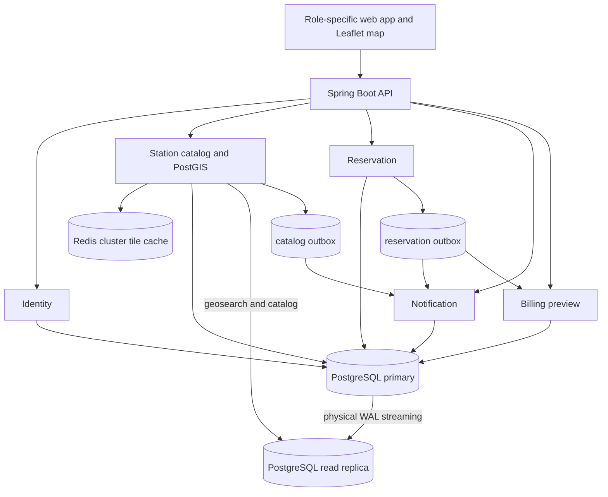

# Local preview architecture

The primary and replica hold one logical database. The replica starts from pg_basebackup and streams WAL in hot standby. Writes, availability checks, moderation decisions, and immediate reads after writes use the primary. Geosearch normally uses the replica and falls back to the primary on failure. The consistent=true map query option explicitly reads the primary.

## Domain boundaries

| Domain | Schema / role | Owns |
|---|---|---|
| Identity | identity / identity_app | Demo accounts, roles, and per-driver saved station IDs |
| Catalog | catalog / catalog_app | Stations, PostGIS points, moderation, catalog outbox |
| Reservation | reservation / booking_app | Time slots, weekly opening hours, date blocks, booking snapshots, reservation outbox |
| Billing | billing / billing_app | Simulated charges and payout shares |
| Notification | notification / notification_app | Inbox items and read state |
| Replica access | replica_reader | Read-only catalog access |

Flyway defines separate schemas and database roles. Cross-schema foreign keys and JOINs are avoided; UUIDs and immutable booking snapshots carry the required references. This modular monolith reflects the service boundaries in the supplied diagrams while keeping a single local deployment.

Saved chargers belong to demo driver profiles in the identity schema. The API reads a bounded list of saved IDs and loads their public catalog records in one query; each driver sees only their own list. Directions are external links to Google Maps, while saved state and booking remain local.

## Booking and settlement

PostgreSQL enforces non-overlapping confirmed slots with a GiST exclusion constraint on station ID and a half-open time range. Station date blocks have their own exclusion constraint. Creation of a booking or block and changes to weekly hours take the same transaction-scoped advisory lock for that station, so schedule checks stay correct under concurrent requests. A block can cover up to 14 days and cannot displace an existing confirmed booking. Weekly hours use each station's local IANA time zone and one opening interval per day; an unset schedule means 24/7. Changes affect new reservations while confirmed bookings remain in place. Availability, station status, weekly hours, blocked dates, and price are checked before booking. Reservations run from 30 minutes to four hours. A confirmed booking stores its own name, address, access note, price, country, and coordinates; directions use those coordinates even if the catalog listing later changes. Cancellation before its start releases the interval.

The booking and its outbox event commit in one transaction. Background handlers create simulated charges and inbox notifications with idempotent event keys. Partner owners receive a calculated 88% share and EC receives 12%. EC-owned stations have no partner payout. The admin event panel previews the local outbox; there is no Kafka broker in this demo.

Flyway adds 16 example future reservations across 12 stations in Czechia and the United States, plus three sample blocked intervals on curated stations. Seed inserts skip any interval already occupied in a persistent local database. The same outbox handlers create simulated settlement and notifications for reservations. The admin station directory and reservation views use bounded, server-side pages. Search indexes support station name, city, and operator filtering; a booking order index supports the reservation pages.

For drivers and owners, reservation pages place the nearest upcoming confirmed slot before past and cancelled records. Administrators retain reverse chronological order. A later migration moves only expired sample schedule blocks forward on upgrade when the new time is free; real and deleted blocks are left alone.

## Map and scale

Flyway enables PostGIS, Point(4326), and spatial indexes. Seed data contains 66,350 fictional Czech locations across 50 cities and towns, 75,000 US locations, and four curated stations. Czech city centers are derived from [GeoNames](https://www.geonames.org/export/) (CC BY 4.0); chargers and addresses are fictional. Search is bounded by map viewport, country, city, and connector. PostGIS groups results with ST_SnapToGrid on a projected grid close to 88 screen pixels per cell at each zoom; Redis caches tile and filter results for 15 minutes. A country cache version increments when stations or moderation decisions change. The browser receives grouped markers and a bounded list of station cards, not the full seed set. A driver can search by arrival time and duration: the browser asks for the nearest 100 stations in view, checks their availability in one reservation batch, and shows up to 24 open results. Map clusters still show all stations; the interface states this distinction.

Redis is a cache, not the source of booking availability. Search falls back to PostgreSQL if Redis is unavailable. Local GeoJSON outlines and search still work without an internet connection; OpenStreetMap background tiles require one.

## Production extension points

The same domain boundaries can later become separate services behind an API gateway. The transactional outbox can feed Kafka, an OCPP adapter can supply station telemetry, and a payment adapter can replace the settlement simulation. Booking conflict enforcement must remain at the transactional primary.
